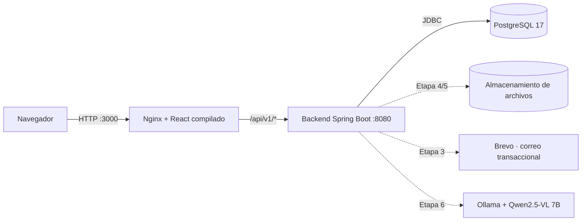

# Arquitectura técnica de LogiCode

> Diseño técnico mínimo (Etapa 1). Fuente de requisitos: `LogiCode - Especificacion para Claude Code.md`, sección 7.
> Estado de cada pieza: ver [estado.md](estado.md).

## Vista general

LogiCode es un **monolito modular**: un único backend Spring Boot con módulos internos, una interfaz React y una base de datos PostgreSQL, todo ejecutado con Docker Compose en local.



Las líneas punteadas son integraciones aprobadas en la especificación que **todavía no están implementadas**.

| Capa (especificación) | Implementación en el repositorio | Estado |
| --- | --- | --- |
| 1. Presentación | `frontend/` React 19 + Vite, JavaScript, CSS propio responsive | Implementada la base |
| 2. Borde y entrega | Nginx en la imagen del frontend: sirve estáticos y reenvía `/api` al backend | Implementada la base (sin TLS: solo local) |
| 3. API e integración | Controladores REST con prefijo `/api/v1`, JSON, errores RFC 9457, OpenAPI (springdoc) | Implementada la base |
| 4. Lógica de negocio | Paquetes `application` y `domain` de cada módulo | Implementada para identidad y permisos (Etapa 3) |
| 5. Tareas lentas | Worker en el mismo backend con tabla de trabajos en PostgreSQL | Pendiente (Etapas 5 y 6) |
| 6. Acceso a datos | Spring Data JPA/Hibernate + Flyway | Implementada (migraciones V1 y V2) |
| 7. Almacenamiento | PostgreSQL; archivos en almacenamiento de objetos o volumen local | PostgreSQL listo; archivos pendientes |
| 8. Infraestructura | `docker-compose.yml`: `db`, `backend`, `frontend` con health checks | Implementada |

## Backend: módulos y capas

Paquete raíz: `co.edu.unipamplona.logicode`. Cada módulo funcional es un paquete hijo directo y se divide en las cuatro capas de la especificación:

```
co.edu.unipamplona.logicode
├── shared/            Transversal: rutas de la API, errores, reloj del negocio, ID de solicitud
├── system/            Módulo de referencia: GET /api/v1/system/info (usa las 4 capas)
│   ├── api/             SystemController, SystemInfoResponse
│   ├── application/     GetSystemInfo (caso de uso), SchemaVersionPort (puerto)
│   ├── domain/          SystemInfo
│   └── infrastructure/  FlywaySchemaVersionAdapter (implementa el puerto)
├── identity/          Etapa 3 · identidad, sesión, correo, recuperación, roles, habilitación de cédulas, auditoría
│   ├── api/             AuthController, MeController, AdminUserController, StudentEnablementController
│   ├── application/     Un caso de uso por clase (RegisterStudent, AuthenticateUser, ResetPassword…) y puertos
│   ├── domain/          UserAccount, OneTimeToken, RecoveryRequest, AccessPolicy, PasswordPolicy…
│   └── infrastructure/  persistence/ (Spring Data), security/ (Spring Security, BCrypt, sesiones), mail/ (outbox, Brevo)
├── files/             Etapa 4 · carga, validación del tipo real, almacenamiento y entrega de archivos
│   ├── application/     FileStore (caso de uso), AcceptedFiles, BinaryStorage y StoredFileRepository (puertos)
│   ├── domain/          StoredFile, FileFormat (formatos, límites y firmas)
│   └── infrastructure/  LocalBinaryStorage (volumen file-storage), persistencia
├── courses/           Etapa 4 · cursos, docente responsable, inscripción por cédula, reglas de acceso (CourseAccess)
├── content/           Etapa 4 · temas, materiales, próxima clase, biblioteca, vista previa y descarga
├── activities/        Etapa 5 · actividades, plazos, entregas
├── grading/           Etapas 5, 6, 8 · rúbricas, calificación determinista e IA, planilla
├── quizzes/           Etapa 7 · quizzes, banco de preguntas, ranking
├── games/             Etapa 7 · juegos de bloques
├── forum/             Etapa 8 · foro y moderación
└── administration/    Etapas 3, 8 · usuarios, aprobación docente, respaldos
```

La habilitación de cédulas quedó en `identity` porque es requisito del registro; la inscripción por curso está en `courses`, que usa `identity` para habilitar la cédula al inscribir. `content` usa `courses` (quién ve o administra un curso) y `files` (archivos); las dependencias van en un solo sentido: content → courses → identity, y content → files. `Role` y `Permission` viven en `shared.domain` (T-29). Los módulos pendientes solo contienen `package-info.java` describiendo su responsabilidad; no tienen código.

### Responsabilidad de cada capa

| Capa | Contiene | No contiene |
| --- | --- | --- |
| `api` | Controladores, DTO de entrada/salida, validación de formato (`@Valid`), traducción a códigos HTTP | Reglas de negocio, SQL, repositorios |
| `application` | Casos de uso (un verbo por clase: `CreateActivity`, `SubmitWork`), transacciones, autorización por caso de uso, puertos (interfaces) hacia infraestructura | Detalles HTTP, implementaciones técnicas |
| `domain` | Entidades, objetos de valor, invariantes y políticas puras (p. ej. escala 0,0-5,0, regla del 80 %) | Spring, acceso a datos, HTTP |
| `infrastructure` | Repositorios JPA, adaptadores (correo Brevo, IA Ollama, almacenamiento de archivos), configuración técnica | Decisiones de negocio |

### Reglas de dependencia (verificadas automáticamente)

`backend/src/test/java/.../architecture/LayeredArchitectureTest.java` (ArchUnit) falla la compilación si:

1. `domain` depende de Spring o de otra capa. Las anotaciones `jakarta.persistence` sí se permiten (T-19).
2. `application` depende de `api` o de `infrastructure` (usa puertos).
3. `api` depende de `infrastructure`.
4. Un `@RestController` está fuera de `api`.
5. `api` usa JDBC, Spring Data o JPA directamente.

6. Un módulo usa `api`, `domain` o `infrastructure` de otro módulo. Entre módulos solo se usa la capa `application` (casos de uso o interfaces públicas); `shared` está disponible para todos.

## Decisiones transversales ya implementadas

| Tema | Implementación |
| --- | --- |
| Prefijo de API | `ApiPaths.V1 = "/api/v1"` en todos los controladores |
| Errores | Problem Details (RFC 9457) en JSON con mensajes en español (`GlobalExceptionHandler`); nunca se devuelve la traza |
| Zona horaria | Datos en UTC (`TIMESTAMPTZ`, JVM en UTC). Reglas por "día calendario en Colombia" usan el `Clock` del negocio (`America/Bogota`, configurable con `LOGICODE_TIME_ZONE`) |
| Trazabilidad | `RequestIdFilter`: cabecera `X-Request-Id` en cada respuesta y en cada línea de log; en Docker los logs son JSON estructurado (ECS) |
| Health checks | `/actuator/health`, `/actuator/health/liveness`, `/actuator/health/readiness` (incluye la base de datos) |
| OpenAPI | `/api/v1/openapi` (JSON) y `/swagger-ui.html` |
| Configuración | Variables de entorno con valores por defecto seguros para desarrollo; secretos fuera del repositorio |
| Seguridad (Etapa 3) | Spring Security con sesión en PostgreSQL (Spring Session JDBC), cookie HttpOnly, CSRF para SPA, `ActiveAccountFilter` que recarga la cuenta en cada petición (una cuenta desactivada pierde el acceso de inmediato) |
| Correo (Etapa 3) | Puerto `EmailSender`; se envía tras confirmar la transacción y en segundo plano; proveedor `outbox` (archivos) o `brevo` |

## Frontend

```
frontend/src
├── app/          Raíz: tabla de rutas, protección por sesión y permiso, barra de navegación
├── pages/        Páginas generales (HomePage provisional)
├── features/     Funcionalidades por módulo: system/, auth/ (sesión y flujos de acceso), account/, admin/
├── shared/api/   Cliente HTTP (httpClient.js): prefijo /api/v1, CSRF, errores RFC 9457; consultas paginadas
├── shared/router/ Enrutador mínimo con la History API (T-20)
├── shared/ui/    Campos de formulario, mensajes, paginador
├── styles/       Estilos globales
└── test/         Configuración de pruebas (Vitest + Testing Library)
```

Regla: la interfaz muestra estado y recoge acciones; **no decide permisos, notas oficiales ni reglas del curso**. Toda autorización se aplica en el backend.

En desarrollo, Vite reenvía `/api` a `http://localhost:8080`; en Docker lo hace Nginx. En ambos casos el navegador ve un único origen, por lo que no se configura CORS.

## Procesos en segundo plano (diseño para Etapas 5-6)

Según la especificación: tabla de trabajos en PostgreSQL y worker dentro del mismo backend; RabbitMQ solo como opción de crecimiento. Diseño previsto: tabla `background_job` (tipo, estado, intentos, próxima ejecución, error), toma de trabajos con `SELECT ... FOR UPDATE SKIP LOCKED`, reintentos con espera creciente y clave de idempotencia para no duplicar calificaciones. No implementado.
