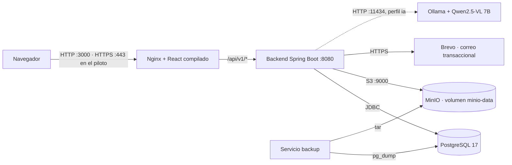
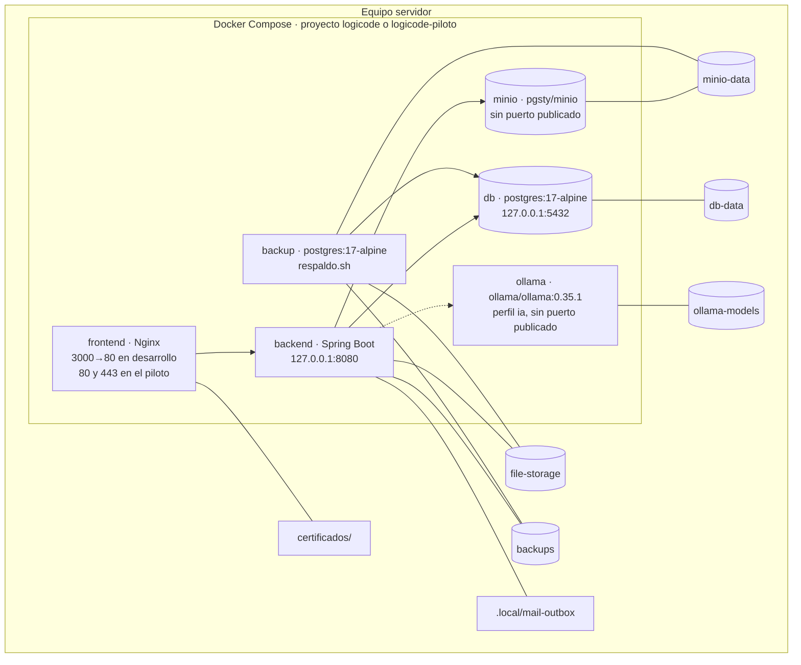
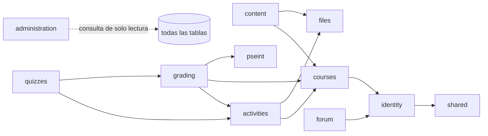
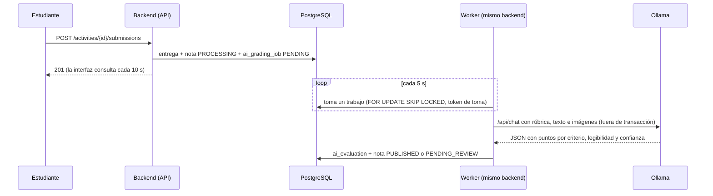

# Arquitectura técnica de LogiCode

> Fuente de requisitos: `LogiCode - Especificacion para Claude Code.md`, sección 7. Estado de cada pieza: [estado.md](estado.md). Revisado contra el código el 2 de noviembre de 2026 (commit `85dca33` y migraciones `V1` a `V9`; la `V10` de la calibración de la IA se agregó el 4 de noviembre).

## Vista general

LogiCode es un **monolito modular**: un único backend Spring Boot con módulos internos, una interfaz React servida por Nginx y una base de datos PostgreSQL, todo ejecutado con Docker Compose en un solo equipo.



La línea punteada es opcional: Ollama solo corre con `docker compose --profile ia` y `LOGICODE_AI_ENABLED=true` (T-45). El correo usa `outbox` (archivos `.html` en `.local/mail-outbox`) hasta arrancar con `docker-compose.brevo.yml`; el remitente es `logicode.notificaciones@gmail.com` (P-06, T-86).

| Capa (especificación) | Implementación en el repositorio | Estado |
| --- | --- | --- |
| 1. Presentación | `frontend/` React 19 + Vite, JavaScript, CSS propio responsive con el estilo del rediseño de Canva | Implementada |
| 2. Borde y entrega | Nginx en la imagen del frontend: sirve los estáticos, reenvía `/api` al backend, cabeceras de seguridad y CSP (Etapa 9), TLS en el modo piloto (Etapa 10) | Implementada. En desarrollo, HTTP local |
| 3. API e integración | Controladores REST con prefijo `/api/v1`, JSON, errores RFC 9457, OpenAPI con springdoc | Implementada |
| 4. Lógica de negocio | Paquetes `application` y `domain` de cada módulo | Implementada (11 módulos de negocio) |
| 5. Tareas lentas | Worker en el mismo backend con tabla de trabajos en PostgreSQL (`ai_grading_job`); envío automático de quizzes vencidos; correos en segundo plano | Implementada. RabbitMQ queda como opción de crecimiento (T-38) |
| 6. Acceso a datos | Spring Data JPA/Hibernate + Flyway | Implementada (migraciones `V1` a `V10`) |
| 7. Almacenamiento | PostgreSQL para datos; archivos en MinIO (compatible con S3) detrás del puerto `BinaryStorage`, con claves aleatorias y acceso solo a través del backend | Implementada (P-05, T-85) |
| 8. Infraestructura | `docker-compose.yml` con `db`, `minio`, `backend`, `frontend`, `backup` y, con el perfil `ia`, `ollama` | Implementada. Alojamiento en línea: P-09, en observación |

## Despliegue con Docker Compose



| Servicio | Imagen | Puerto publicado | Volúmenes | Notas |
| --- | --- | --- | --- | --- |
| `db` | `postgres:17-alpine` | `127.0.0.1:${DB_PORT:-5432}` | `db-data` | Nunca se expone a la red (T-11) |
| `minio` | `pgsty/minio:RELEASE.2026-08-04T00-00-00Z` (fork comunitario de MinIO, T-85) | Ninguno | `minio-data` | Archivos cargados. Usuario y contraseña en `.env` (`MINIO_ROOT_USER`, `MINIO_ROOT_PASSWORD`) |
| `backend` | Se construye desde `backend/` | `127.0.0.1:${BACKEND_PORT:-8080}` | `file-storage` (cargas en curso y archivos de antes de MinIO), `backups` (solo lectura de lo que deja `backup` y escritura de la petición), `./.local/mail-outbox` | Arranca cuando `db` y `minio` están sanos; aplica las migraciones Flyway al iniciar |
| `frontend` | Se construye desde `frontend/` (Nginx) | `${FRONTEND_PORT:-3000}:80`; en el piloto `80` y `443` | En el piloto, `./certificados` | Crea la autoridad y el certificado locales si faltan (`frontend/nginx/https.sh`, T-67) |
| `backup` | `postgres:17-alpine` | Ninguno | `file-storage`, `minio-data`, `backups` | Copia diaria a la hora `BACKUP_HOUR` (Colombia), prueba de restauración y retención `BACKUP_RETENTION_DAYS` (T-63) |
| `ollama` | `ollama/ollama:0.35.1` | Ninguno | `ollama-models` | Solo con `--profile ia`; un modelo y una petición a la vez |

Archivos de Compose adicionales:

| Archivo | Qué cambia |
| --- | --- |
| `docker-compose.piloto.yml` | `LOGICODE_ENVIRONMENT=piloto`, cookies `Secure`, documentación de la API apagada, HTTPS en los puertos 80 (redirige) y 443. Guía: [piloto.md](piloto.md) |
| `docker-compose.brevo.yml` | `LOGICODE_MAIL_PROVIDER=brevo`, el remitente `BREVO_SENDER_EMAIL` y el secreto de Docker `brevo_api_key` (archivo en `secrets/`, fuera de Git) |

## Recorrido de una petición

1. El navegador pide `https://<servidor>/api/v1/...` (o `http://localhost:3000/...` en desarrollo). Solo existe un origen, así que no hay CORS.
2. Nginx sirve los archivos de React y reenvía todo lo que empieza por `/api/` a `http://backend:8080` con `X-Forwarded-Proto`. El cuerpo admite hasta 1,1 GB (videos de 1 GB).
3. En Spring: `RequestIdFilter` asigna o propaga `X-Request-Id` y deja una línea de log por solicitud; Spring Security valida la sesión (cookie `LOGICODE_SESSION`) y el token CSRF en toda escritura; `ActiveAccountFilter` recarga la cuenta en cada petición, de modo que una cuenta desactivada pierde el acceso de inmediato.
4. El controlador (`api`) valida el formato y llama a un caso de uso (`application`), que comprueba el permiso (`AccessPolicy`) y la pertenencia al curso, abre la transacción y usa el dominio y los puertos.
5. Los adaptadores (`infrastructure`) hablan con PostgreSQL, MinIO, Brevo u Ollama. La respuesta sale como JSON o como Problem Details (RFC 9457) en español.

## Backend: módulos y capas

Paquete raíz: `co.edu.unipamplona.logicode`. Cada módulo funcional es un paquete hijo directo con las cuatro capas de la especificación (`api`, `application`, `domain`, `infrastructure`; un módulo puede no tener alguna si no la necesita).

| Módulo | Etapa | Qué es suyo | Controladores |
| --- | --- | --- | --- |
| `shared` | 2 | Rutas `/api/v1` (`ApiPaths`), errores RFC 9457, reloj del negocio (`America/Bogota`), `X-Request-Id`, `Role` y `Permission` (T-29) | — |
| `system` | 2 | Información del sistema y versión del esquema (módulo de referencia con las 4 capas) | `SystemController` |
| `identity` | 3 | Cuentas, roles, privilegio completo, sesión, verificación de correo, recuperación de contraseña, cambio asistido de correo, habilitación de cédulas, auditoría, cuentas iniciales | `AuthController`, `MeController`, `AdminUserController`, `StudentEnablementController` |
| `files` | 4 | Validación de extensión, tamaño y firma real; metadatos `stored_file`; almacenamiento local con claves aleatorias; retención y borrado de vencidos (`FileUsage` lo implementan `content` y `activities`) | — (lo usan otros módulos) |
| `courses` | 4 | Cursos, docente responsable, inscripción por cédula (CSV y `.xlsx`), reglas de acceso al curso (`CourseAccess`) | `CourseController` |
| `content` | 4 | Temas, materiales, próxima clase, biblioteca pública, vista previa y descarga | `TopicController`, `MaterialController`, `LibraryController` |
| `activities` | 5 | Actividades, plazos, intentos, entregas, excepciones de plazo; define el puerto `GradingGateway` y expone `ActivityCatalog` | `ActivityController`, `SubmissionController` |
| `grading` | 5-8 | Rúbricas versionadas (con casos de prueba y reto de bloques), notas, Por revisar, historial, calificación con IA (cola y worker), calificación automática de PSeInt y retos de bloques, planilla y exportación CSV/`.xlsx` | `GradingController`, `GradebookController` |
| `pseint` | 7 | Intérprete de PSeInt propio con límites (dominio puro) y ejecución de casos de prueba | `PseintController` |
| `quizzes` | 7 | Banco de preguntas, quizzes, intentos, envío automático al vencer, nota y ranking | `QuizController` |
| `forum` | 8 | Hilos y respuestas por herramienta, moderación | `ForumController` |
| `administration` | 8 | Cifras del panel y respaldos (lee el volumen `backups`) | `AdministrationController` |

Los **juegos** no tienen módulo en el backend: corren solo en el navegador (`frontend/src/features/games`, T-59). La única parte de bloques con servidor es el **reto de bloques calificable** (RF-12), que vive en `grading` (`BlockChallenge`, copia en Java del intérprete de `games/blocks.js`, T-74).



Las flechas indican "usa la capa `application` de". `grading` implementa el puerto `GradingGateway` que define `activities` (T-30), así la dependencia va en un solo sentido. `administration` cuenta en todas las tablas con una consulta de solo lectura (T-62) en lugar de pedir cifras a cada módulo. Todos los módulos usan `shared`.

### Responsabilidad de cada capa

| Capa | Contiene | No contiene |
| --- | --- | --- |
| `api` | Controladores, DTO de entrada/salida, validación de formato (`@Valid`), traducción a códigos HTTP | Reglas de negocio, SQL, repositorios |
| `application` | Casos de uso (un verbo por clase: `SubmitWork`, `ManageRubrics`), transacciones, autorización por caso de uso, puertos (interfaces) hacia infraestructura | Detalles HTTP, implementaciones técnicas |
| `domain` | Entidades, objetos de valor, invariantes y políticas puras (escala 0,0-5,0, regla del 80 %, intérprete de PSeInt, `BlockChallenge`) | Spring, acceso a datos, HTTP |
| `infrastructure` | Repositorios JPA, adaptadores (correo, Ollama, disco), seguridad, tareas programadas | Decisiones de negocio |

### Reglas de dependencia (verificadas automáticamente)

`backend/src/test/java/co/edu/unipamplona/logicode/architecture/LayeredArchitectureTest.java` (ArchUnit) falla la compilación si:

1. `domain` depende de Spring o de otra capa. Las anotaciones `jakarta.persistence` sí se permiten (T-19).
2. `application` depende de `api` o de `infrastructure` (usa puertos).
3. `api` depende de `infrastructure`.
4. Un `@RestController` está fuera de `api`.
5. `api` usa JDBC, Spring Data o JPA directamente.
6. Un módulo usa `api`, `domain` o `infrastructure` de otro módulo. Entre módulos solo se usa la capa `application` (casos de uso o interfaces públicas); `shared` está disponible para todos.

## Procesos en segundo plano

| Proceso | Dónde | Frecuencia | Qué hace |
| --- | --- | --- | --- |
| Worker de IA | `grading/infrastructure/ai/AiGradingWorker` | Cada `logicode.ai.poll-interval` (5 s) cuando la IA está encendida | Toma un trabajo de `ai_grading_job` y lo evalúa con Ollama |
| Liberación de la cola | `AiQueueRelease` | Al arrancar con la IA apagada | Pasa al docente los trabajos que quedaron en cola |
| Envío de quizzes vencidos | `quizzes/infrastructure/QuizDeadlineSweeper` | Cada 30 s | Envía con lo guardado los intentos cuyo tiempo terminó (T-56) |
| Correos | Puerto `EmailSender` | Después de confirmar la transacción | Envía en segundo plano por `outbox` o Brevo (T-15) |
| Respaldos | Contenedor `backup` (`respaldos/respaldo.sh`) | Diario y a pedido desde el panel | `pg_dump` + `tar`, prueba de restauración, retención |
| Borrado de archivos vencidos | `files/infrastructure/ExpiredFileSchedule` | Diario, 3:30 a. m. (Colombia), después del respaldo | Borra los archivos con `retain_until` vencida que ningún módulo reporta en uso (`FileUsage`, T-88) |

### Cola de calificación con IA

Tabla de trabajos en PostgreSQL y worker dentro del mismo backend, como pide la especificación (T-38). El recorrido completo, con sus alternativas, está en el diagrama de secuencia [4-secuencia.mmd](diagramas/4-secuencia.mmd) ([imagen](diagramas/4-secuencia.png)); los estados de la nota, en [casos-de-uso.md](casos-de-uso.md#estados-de-una-entrega).



- **Toma:** `lockNext` usa `FOR UPDATE SKIP LOCKED`; cada toma recibe un `claim_token`. Un trabajo `RUNNING` cuyo bloqueo pasó de `timeout + 2 min` se retoma, y el resultado viejo se descarta porque su token ya no coincide.
- **Reintentos:** un fallo técnico se reintenta hasta `LOGICODE_AI_MAX_ATTEMPTS` veces con espera creciente; al agotarse, la nota pasa a Por revisar con motivo `AI_FAILED` y sin nota (RF-15, RNF-06).
- **Decisión:** el dominio (`AiGradingPolicy`) calcula la nota con la rúbrica y publica solo si el contenido es legible y la confianza es de 80 % o más; si no, la propuesta espera al docente (RN-09, RN-11). El umbral es fijo (T-40).
- **Contenido:** respuestas escritas, fotos PNG/JPG (enderezadas y reducidas en `ImagePreparer`), `.psc`/`.ino` como texto y, desde P-08, PDF de hasta 5 páginas (texto y cada página como imagen, `PdfContent`, T-77). Word, PowerPoint, video y `.sb3` van al docente como "Formato que la IA no lee".
- **Privacidad:** al modelo van el nombre del estudiante, el enunciado, la respuesta esperada, los criterios y el contenido con etiquetas neutras; nunca cédula, correo ni nombres de archivo (T-44).
- **Sin IA:** con `LOGICODE_AI_ENABLED=false` no hay worker; las entregas van a Por revisar como `AI_DISABLED`.
- **Integración:** el puerto `GradingProvider` (aplicación) lo implementa `OllamaGradingAdapter` (infraestructura).

### Flujo de datos de entregar y calificar

El análisis de la Etapa 6 modeló este flujo como DFD (notación Yourdon/DeMarco simplificada). Los diagramas se conservan en [diagramas/](diagramas/):

| Diagrama | Fuente | Imagen | Nota |
| --- | --- | --- | --- |
| DFD de contexto | [1-dfd-contexto.mmd](diagramas/1-dfd-contexto.mmd) | [PNG](diagramas/1-dfd-contexto.png) | Estudiante, docente y el servicio de IA local alrededor del proceso "Entregar y calificar actividades" |
| DFD de nivel 1 | [2-dfd-nivel1.mmd](diagramas/2-dfd-nivel1.mmd) | [PNG](diagramas/2-dfd-nivel1.png) | Seis procesos (recibir, encolar, evaluar, aplicar la política de confianza, revisar, consultar) y seis almacenes (D1 actividades y rúbricas, D2 entregas, D3 archivos, D4 notas e historial, D5 cola, D6 evaluaciones IA) |
| Secuencia | [4-secuencia.mmd](diagramas/4-secuencia.mmd) | [PNG](diagramas/4-secuencia.png) | Entregar una actividad y calificarla con IA, con sus alternativas |

El dibujo de los DFD sigue vigente. Lo que cambió desde el análisis: el flujo F9 (contenido que llega a la IA) ahora incluye los PDF, porque desde P-08 la IA lee su texto y sus páginas como imágenes.

## Seguridad

| Tema | Implementación |
| --- | --- |
| Sesión | Spring Session JDBC: la sesión vive en PostgreSQL (`spring_session`), cookie `LOGICODE_SESSION` HttpOnly, `Secure` en el piloto; vence tras `SESSION_TIMEOUT` sin actividad (2 h por defecto) (D-01) |
| CSRF | Protección para SPA: cookie `XSRF-TOKEN` y cabecera `X-XSRF-TOKEN` en toda escritura; sin token, `403` |
| Contraseñas | BCrypt; solo el hash actual y el inmediatamente anterior (D-02, RNF-02). Cambiar o restablecer la contraseña borra todas las sesiones de la cuenta |
| Intentos fallidos | 5 en 15 minutos por cédula → `429` (T-16) |
| Autorización | `AccessPolicy` calcula los permisos por rol, estado y privilegio completo; cada caso de uso exige el suyo. Matriz en [permisos.md](permisos.md) |
| Lo que no se puede ver | Responde `404` en lugar de `403`, para no revelar cursos o materiales privados (T-27) |
| Cabeceras en Nginx | `Content-Security-Policy` (`default-src 'self'`, sin incrustar en otros sitios), `X-Content-Type-Options`, `Referrer-Policy`; sin versión de Nginx (D9-02). Las fuentes van como archivos propios (T-82) |
| HTTPS | Modo piloto con certificado local o de la Universidad (T-67); en desarrollo, HTTP en `localhost` |
| Archivos | Firma real, extensión y tamaño validados; claves aleatorias; descarga con permisos y `nosniff` |
| Ejecución de código | Intérprete de PSeInt sin instrucciones de archivos, red ni sistema, con límites de tiempo, pasos y memoria (T-49, T-50) |
| Secretos | `.env`, `secrets/` y `certificados/` fuera de Git; API key de Brevo como secreto de Docker; contraseña de MinIO en `.env` |
| Puertos | Base y backend solo en `127.0.0.1`; desde la red solo se llega a Nginx |

## Decisiones transversales ya implementadas

| Tema | Implementación |
| --- | --- |
| Prefijo de API | `ApiPaths.V1 = "/api/v1"` en todos los controladores |
| Errores | Problem Details (RFC 9457) en JSON con mensajes en español (`GlobalExceptionHandler`); nunca se devuelve la traza |
| Zona horaria | Datos en UTC (`TIMESTAMPTZ`, JVM en UTC). Reglas por "día calendario en Colombia" usan el `Clock` del negocio (`America/Bogota`, configurable con `LOGICODE_TIME_ZONE`) |
| Trazabilidad | `X-Request-Id` en cada respuesta y línea de log; una línea por solicitud con estado y duración; logs JSON (ECS) en Docker; métricas en `/actuator/metrics`, solo desde el equipo servidor |
| Health checks | `/actuator/health`, `/actuator/health/liveness`, `/actuator/health/readiness` (incluye la base de datos) |
| OpenAPI | springdoc: `/api/v1/openapi` (JSON) y `/swagger-ui.html`; apagados en el modo piloto |
| Configuración | Variables de entorno con valores por defecto seguros para desarrollo; secretos fuera del repositorio |

## Frontend

```
frontend/src
├── app/          App.jsx: tabla de rutas, protección por sesión y permiso, barra superior con iconos
├── pages/        HomePage (inicio con misión, visión y estado de la plataforma)
├── features/     Una carpeta por funcionalidad:
│   ├── auth/          ingreso, registro, verificación, recuperación, cambio de correo, sesión
│   ├── account/       Mi cuenta y etiquetas de roles y permisos
│   ├── admin/         panel, usuarios, habilitación de cédulas, auditoría
│   ├── courses/       cursos, pestañas del curso, temas, estudiantes
│   ├── content/       biblioteca, material, moderación de materiales
│   ├── activities/    actividades, entrega, rúbrica, reto de bloques, Por revisar
│   ├── quizzes/       banco de preguntas, armado del quiz, intento
│   ├── gradebook/     planilla y exportación
│   ├── pseint/        editor e intérprete
│   ├── games/         catálogo y juegos (solo navegador)
│   ├── forum/         foro e hilo
│   └── system/        estado de la plataforma
├── shared/api/   Cliente HTTP (httpClient.js): prefijo /api/v1, CSRF, errores RFC 9457, consultas paginadas
├── shared/router/ Enrutador mínimo con la History API (T-20)
├── shared/ui/    Campos de formulario, mensajes, paginador, iconos (Icon.jsx)
├── styles/       global.css (colores, letras y componentes del rediseño)
└── test/         Configuración de Vitest + Testing Library
```

Rutas principales: `/`, `/ingresar`, `/registro/estudiante`, `/registro/docente`, `/mi-cuenta`, `/biblioteca`, `/materiales/:id`, `/cursos`, `/cursos/:id` (pestañas por `?seccion=`), `/actividades/:id`, `/entregas/:id`, `/quiz-intentos/:id`, `/juegos` (`?juego=<clave>&nivel=<id>`), `/pseint`, `/foro`, `/foro/:id`, `/admin`, `/admin/usuarios`, `/admin/habilitaciones`, `/admin/auditoria`.

Regla: la interfaz muestra estado y recoge acciones; **no decide permisos, notas oficiales ni reglas del curso**. Ocultar una opción del menú es solo comodidad; toda autorización se aplica en el backend.

### Juegos (solo en el navegador)

`/juegos` es público y no usa la API. Los niveles están fijos en `features/games/levels.js`; el avance se guarda en `localStorage` (`logicode.juegos.v1`) y el personaje del robot en `logicode.juegos.personaje`. Si el navegador no deja guardar, se juega igual sin recordar. El catálogo sale de la lista `GAMES` de `GamesPage.jsx`: agregar un juego es agregar una entrada (T-83).

| Juego (clave) | Herramienta | Niveles | Componente |
| --- | --- | --- | --- |
| Bloques (`bloques`) | Scratch | 24 | `BlocksGame.jsx` + intérprete `blocks.js` (tope de 400 pasos) |
| ¿Qué imprime? (`salida`) | PSeInt | 21 | `OutputGame.jsx` |
| Caza el error (`error`) | PSeInt | 14 | `ErrorGame.jsx` |
| Prueba de escritorio (`escritorio`) | PSeInt | 12 | `DeskGame.jsx` (tabla de valores; `sameDeskValue` compara las respuestas) |
| Ordena el algoritmo (`orden`) | PSeInt | 14 | `OrderGame.jsx` |
| Completa el DFD (`dfd`) | DFD | 14 | `DfdGame.jsx` (diagrama en SVG, con figura de ciclo) |
| ¿Qué hace este código? (`arduino`) | Arduino | 12 | `OutputGame.jsx` con una pregunta propia por nivel |

Un editor de niveles para el docente en `/juegos` es **Pendiente** (no pedido, T-59 y T-78); el docente configura retos **con nota** en la rúbrica de una actividad (RF-12).

En desarrollo, Vite reenvía `/api` a `http://localhost:8080`; en Docker lo hace Nginx.
