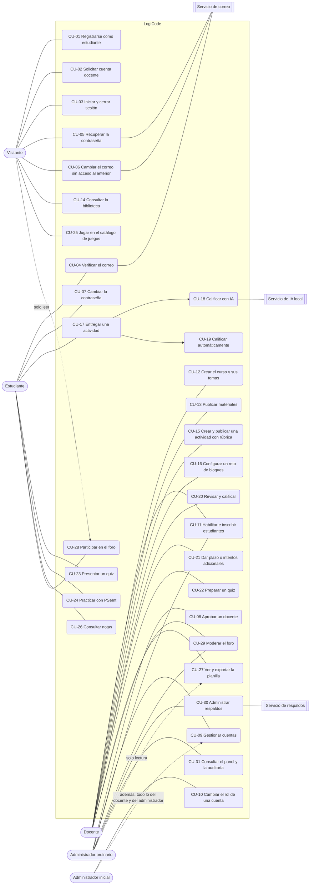
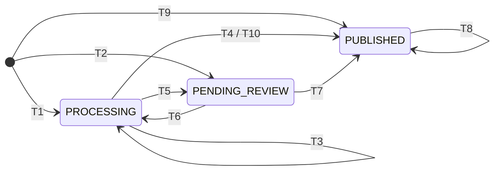

# Casos de uso

Documento de la Etapa 1 (análisis y diseño), escrito después de construir el sistema y verificado contra el código el 1 de noviembre de 2026. Cada caso indica los requisitos (RF, RNF) y reglas de negocio (RN) de la [especificación](../LogiCode%20-%20Especificacion%20para%20Claude%20Code.md) que cubre y su estado:

- **Implementado**: existe en el código y tiene prueba o verificación ([estado.md](estado.md)).
- **Pendiente**: no existe o no se ha ejecutado.

Las historias de usuario con criterios de aceptación están en [historias-de-usuario.md](historias-de-usuario.md) y las pantallas de cada caso, en [maquetas.md](maquetas.md).

## Actores

| Actor | Descripción |
| --- | --- |
| Visitante | Persona sin sesión |
| Estudiante | Cuenta con rol Estudiante, inscrita por cédula en un curso |
| Docente | Cuenta con rol Docente aprobada; administra los cursos de los que es responsable |
| Administrador ordinario | Cuenta con rol Administrador sin privilegio completo |
| Administrador inicial | Una de las dos cuentas con privilegio completo (Carlos Alberto Escamilla Mariño y Yarly Melitza Guerrero Berbesi); puede todo lo de los demás actores y además cambiar roles |
| Servicio de IA local | Ollama con Qwen2.5-VL 7B; actor secundario del sistema |
| Servicio de correo | Brevo (o la bandeja local en desarrollo); actor secundario |
| Servicio de respaldos | Contenedor `backup`; actor secundario temporizado |

## Diagrama de casos de uso

Los casos de uso de cuentas (CU-03, CU-04, CU-07) aplican a todos los actores con cuenta; en el diagrama se dibujan solo con el Estudiante para no repetir líneas.

## Resumen

| Id | Caso de uso | Actor principal | Requisitos | Estado |
| --- | --- | --- | --- | --- |
| CU-01 | Registrarse como estudiante | Visitante | RF-01, RN-01 | Implementado |
| CU-02 | Solicitar cuenta docente | Visitante | RF-02, RN-02 | Implementado |
| CU-03 | Iniciar y cerrar sesión | Cualquier cuenta | RF-03 | Implementado |
| CU-04 | Verificar el correo | Cualquier cuenta | RF-29, RN-24 | Implementado; envío real con Brevo probado el 1 de noviembre en el equipo de Carlos con `logicode.notificaciones@gmail.com` (P-06) |
| CU-05 | Recuperar la contraseña | Cualquier cuenta | RF-04, RN-23 | Implementado; envío real con Brevo probado el 1 de noviembre en el equipo de Carlos con `logicode.notificaciones@gmail.com` (P-06) |
| CU-06 | Cambiar el correo sin acceso al anterior | Cualquier cuenta | RF-30, RN-25 | Implementado |
| CU-07 | Cambiar la contraseña | Cualquier cuenta | RNF-02 | Implementado |
| CU-08 | Aprobar un docente | Administrador | RF-02, RF-28, RN-02 | Implementado |
| CU-09 | Gestionar cuentas (buscar, activar, desactivar) | Administrador | RF-28, RN-16 | Implementado |
| CU-10 | Cambiar el rol de una cuenta | Administrador inicial | RF-28, RN-04, RN-16, RN-22 | Implementado |
| CU-11 | Habilitar e inscribir estudiantes | Docente, Administrador | RF-05, RN-01, RN-03 | Implementado |
| CU-12 | Crear el curso y sus temas | Docente | RF-06, RF-09 | Implementado |
| CU-13 | Publicar materiales | Docente | RF-07, RF-08, RNF-04, RN-17, RN-21 | Implementado |
| CU-14 | Consultar la biblioteca y previsualizar materiales | Visitante y todos | RF-24, RF-25, RN-03, RN-17 | Implementado |
| CU-15 | Crear y publicar una actividad con rúbrica | Docente | RF-10, RF-11, RF-12, RN-07, RN-20 | Implementado |
| CU-16 | Configurar un reto de bloques | Docente | RF-12, RN-20 | Implementado |
| CU-17 | Entregar una actividad | Estudiante | RF-13, RF-19, RN-05, RNF-04 | Implementado |
| CU-18 | Calificar con IA | Servicio de IA local (iniciado por CU-17) | RF-14, RF-15, RN-08, RN-09, RN-11, RN-18, RNF-03, RNF-06 a RNF-08 | Implementado; pruebas de aceptación de Qwen **Pendientes** |
| CU-19 | Calificar automáticamente (PSeInt, reto de bloques) | Sistema (iniciado por CU-17) | RF-12, RF-16, RNF-05 | Implementado |
| CU-20 | Revisar y calificar una entrega | Docente | RF-15, RF-17, RN-06, RN-09 | Implementado |
| CU-21 | Dar plazo o intentos adicionales | Docente | RF-11, RN-05 | Implementado |
| CU-22 | Preparar un quiz | Docente | RF-10, RF-21, RN-13, RN-20 | Implementado |
| CU-23 | Presentar un quiz | Estudiante | RF-16, RF-21, RN-13, RN-14 | Implementado |
| CU-24 | Practicar con el editor de PSeInt | Estudiante, Docente | RNF-05 | Implementado |
| CU-25 | Jugar en el catálogo de juegos | Visitante y todos | RF-22, RN-19 | Implementado |
| CU-26 | Consultar notas y retroalimentación | Estudiante | RF-19, RF-20 | Implementado |
| CU-27 | Ver y exportar la planilla | Docente, Administrador (lectura) | RF-18, RN-07 | Implementado |
| CU-28 | Participar en el foro | Estudiante, Docente, Administrador; Visitante solo lee | RF-26 | Implementado |
| CU-29 | Moderar el foro | Docente, Administrador | RF-27, RN-15 | Implementado |
| CU-30 | Administrar respaldos | Administrador | RNF-09, RF-28 | Implementado (restaurar es por consola) |
| CU-31 | Consultar el panel de administración y la auditoría | Administrador | RF-28 | Implementado |
| CU-32 | Editar los niveles de `/juegos` | Docente | RF-22 | **Pendiente** (no pedido; los niveles están fijos en el código) |

## Detalle

### CU-01 Registrarse como estudiante

- **Actor:** Visitante. **Requisitos:** RF-01, RN-01, RNF-02. **Estado:** Implementado.
- **Precondición:** un docente o administrador habilitó la cédula (CU-11).
- **Flujo principal:**
  1. El visitante abre **Registrarme como estudiante**.
  2. Escribe cédula, nombre completo, correo y contraseña.
  3. El sistema valida que la cédula esté habilitada y sin cuenta, que el correo no esté en uso y que la contraseña tenga 8 caracteres o más, un número y un carácter especial.
  4. Crea la cuenta activa, guarda el hash BCrypt y envía el enlace de verificación del correo (CU-04).
- **Alternativos y excepciones:**
  - Cédula no habilitada → mensaje para pedir la habilitación al docente; no se crea la cuenta.
  - Cédula o correo ya registrados → `409` con el motivo.
  - Contraseña débil → el formulario indica la regla.
- **Postcondición:** cuenta Estudiante activa; si la cédula está inscrita en un curso, ve su contenido privado al ingresar.

### CU-02 Solicitar cuenta docente

- **Actor:** Visitante. **Requisitos:** RF-02, RN-02. **Estado:** Implementado.
- **Precondición:** ninguna.
- **Flujo principal:** el visitante abre **Solicitar cuenta de docente**, escribe cédula, nombre, correo y contraseña; el sistema crea la cuenta en estado "Pendiente de aprobación" y envía la verificación del correo.
- **Excepciones:** cédula o correo ya registrados → `409`. Intentar ingresar antes de la aprobación → `403` con el aviso.
- **Postcondición:** la solicitud aparece en **Usuarios** con el filtro de estado "Pendiente de aprobación" (CU-08).

### CU-03 Iniciar y cerrar sesión

- **Actor:** cualquier cuenta. **Requisitos:** RF-03, RNF-02. **Estado:** Implementado.
- **Precondición:** cuenta activa con contraseña.
- **Flujo principal:** el usuario escribe cédula y contraseña en **Iniciar sesión**; el sistema crea una sesión nueva en PostgreSQL y devuelve la cuenta con sus permisos; la interfaz muestra el menú según los permisos. **Cerrar sesión** borra la sesión.
- **Excepciones:** datos incorrectos → `401` genérico. Cuenta pendiente o desactivada → `403`. Cinco intentos fallidos en 15 minutos para una cédula → `429` hasta que pase la ventana (T-16). Sin actividad durante `SESSION_TIMEOUT` (2 h) la sesión vence.
- **Postcondición:** sesión activa (cookie `LOGICODE_SESSION`) y evento en la auditoría.

### CU-04 Verificar el correo

- **Actor:** cualquier cuenta; secundario: servicio de correo. **Requisitos:** RF-29, RN-24. **Estado:** Implementado; envío real con Brevo probado el 1 de noviembre en el equipo de Carlos con `logicode.notificaciones@gmail.com` (P-06).
- **Precondición:** cuenta con correo sin verificar.
- **Flujo principal:** el sistema genera un token aleatorio de un solo uso (guarda solo su hash) y envía el enlace; el usuario lo abre; el sistema marca el correo como verificado y consume el token.
- **Alternativos:** el enlace vence a las 24 horas (T-13) → se pide otro desde **Mi cuenta** ("reenviar"). Para una cuenta inicial sin contraseña, el enlace indica que falta crearla y se crea con CU-05.
- **Postcondición:** la cuenta puede recuperar su contraseña por correo.

### CU-05 Recuperar la contraseña

- **Actor:** cualquier cuenta; secundario: servicio de correo. **Requisitos:** RF-04, RN-23, RNF-02. **Estado:** Implementado; envío real con Brevo probado el 1 de noviembre en el equipo de Carlos con `logicode.notificaciones@gmail.com` (P-06).
- **Precondición:** correo verificado.
- **Flujo principal:**
  1. En **¿Olvidaste tu contraseña?** el usuario escribe su correo.
  2. El sistema responde siempre con el mismo mensaje genérico, exista o no la cuenta.
  3. Si la cuenta existe, tiene el correo verificado y no pasó el límite, genera un token de un solo uso válido 60 minutos y envía el enlace.
  4. El usuario abre el enlace y escribe la contraseña nueva (8 o más caracteres, un número y un carácter especial).
  5. El sistema guarda el hash nuevo, pasa el actual a "anterior", consume el token y cierra todas las sesiones de la cuenta.
- **Excepciones:** más de 2 solicitudes en el mismo día calendario de Colombia → no se envía (contador propio, D-04). Token vencido o usado → rechazo; se pide otro. Emitir un token nuevo invalida los anteriores sin usar.
- **Postcondición:** contraseña nueva; ninguna sesión anterior sigue abierta.

### CU-06 Cambiar el correo sin acceso al anterior

- **Actor:** cualquier cuenta. **Requisitos:** RF-30, RN-25. **Estado:** Implementado.
- **Flujo principal:** en **¿Ya no tienes acceso a tu correo?** el usuario escribe cédula, el último correo registrado, la contraseña actual o la inmediatamente anterior y el correo nuevo; si coinciden, el sistema envía un enlace al correo nuevo, que reemplaza al anterior solo cuando se confirma.
- **Excepciones:** datos que no coinciden → no cambia nada (el intento cuenta para el límite). Límite de 2 solicitudes diarias por cuenta, con un contador distinto al de la recuperación de contraseña. La respuesta es genérica.
- **Postcondición:** correo nuevo verificado y usado para recuperación; la contraseña ingresada no se guarda.

### CU-07 Cambiar la contraseña

- **Actor:** cualquier cuenta. **Requisitos:** RNF-02. **Estado:** Implementado.
- **Flujo principal:** en **Mi cuenta** escribe la contraseña actual y la nueva; el sistema la valida, rota los hashes (actual → anterior) y cierra todas las sesiones, incluida la actual.

### CU-08 Aprobar un docente

- **Actor:** Administrador (ordinario o inicial). **Requisitos:** RF-02, RF-28, RN-02. **Estado:** Implementado.
- **Precondición:** solicitud en "Pendiente de aprobación".
- **Flujo principal:** en **Usuarios**, filtro de estado "Pendiente de aprobación", **Aprobar**. La cuenta pasa a activa con permisos de docente.
- **Postcondición:** el docente puede ingresar y crear cursos; queda en la auditoría.

### CU-09 Gestionar cuentas

- **Actor:** Administrador. **Requisitos:** RF-28, RN-16. **Estado:** Implementado.
- **Flujo principal:** en **Usuarios** busca por cédula, nombre o correo y filtra por rol y estado; **Desactivar** o **Activar** una cuenta. Desactivar cierra sus sesiones y le quita el acceso de inmediato.
- **Excepciones:** un administrador ordinario no puede desactivar ni cambiar una cuenta con privilegio completo; nadie puede dejar la plataforma sin una cuenta inicial activa (`422`).
- **No disponible:** crear cuentas desde el panel. Las cuentas nacen por registro (CU-01, CU-02) o, las iniciales, desde `.env`.

### CU-10 Cambiar el rol de una cuenta

- **Actor:** Administrador inicial. **Requisitos:** RF-28, RN-04, RN-16, RN-22. **Estado:** Implementado.
- **Flujo principal:** en **Usuarios**, la columna Rol muestra una lista (solo para las cuentas iniciales); al elegir otro rol, el sistema lo guarda y cierra las sesiones de esa cuenta.
- **Excepciones:** un administrador ordinario recibe `403`. El privilegio completo no se otorga por la web: solo lo tienen las cuentas de `INITIAL_ADMIN_*`, y al arrancar el backend lo restablece (T-17).

### CU-11 Habilitar e inscribir estudiantes

- **Actor:** Docente (en su curso), Administrador. **Requisitos:** RF-05, RN-01, RN-03. **Estado:** Implementado.
- **Flujo principal:**
  1. En el curso, pestaña **Estudiantes**, el docente escribe una cédula (y el nombre, opcional) y pulsa **Inscribir**, o elige un archivo y pulsa **Importar lista**.
  2. La lista puede ser `.xlsx` (primera hoja, cédula en la columna A, nombre opcional en la B) o `.csv` (`cedula` o `cedula,nombre`), de hasta 1 MB y 2000 filas, con encabezado opcional.
  3. El sistema inscribe y habilita cada cédula válida y responde cuántas se inscribieron, cuántas ya estaban y qué filas tienen errores.
- **Alternativos:** **Habilitar estudiantes** (menú) habilita cédulas sin inscribirlas en un curso. **Retirar** saca a un estudiante del curso sin borrar su cuenta.
- **Excepciones:** `.xls` antiguo u otro formato, archivo de más de 1 MB o dañado → rechazo con el motivo; cédula con caracteres que no son dígitos → fila con error.
- **Postcondición:** las cédulas pueden registrarse (CU-01) y ver el contenido privado del curso.

### CU-12 Crear el curso y sus temas

- **Actor:** Docente. **Requisitos:** RF-06, RF-09. **Estado:** Implementado.
- **Flujo principal:** **Cursos** → **Crear curso** (nombre, periodo, descripción); quien lo crea queda como responsable. En la pestaña **Temas**, **Nuevo tema** con título, descripción y herramienta (PSeInt, DFD, Scratch, Arduino o General); **Subir** y **Bajar** ordenan; **Marcar como próxima clase** (uno por curso); **Archivar tema** lo oculta.
- **Excepciones:** un administrador ordinario no crea temas (`403`).

### CU-13 Publicar materiales

- **Actor:** Docente. **Requisitos:** RF-07, RF-08, RNF-04, RNF-12, RN-17, RN-21. **Estado:** Implementado.
- **Flujo principal:** en un tema, **Agregar material a este tema**: título, tipo, visibilidad (Público o Privado) y un archivo o un enlace. El sistema valida extensión, firma real y tamaño (500 MB; videos 1 GB), guarda el archivo con una clave aleatoria y fija su retención mínima de seis meses.
- **Alternativos:** **Hacer público** / **Hacer privado**; **Archivar** oculta sin borrar el archivo. Un administrador puede cambiar la visibilidad y archivar, pero no crear ni editar.
- **Excepciones:** formato no aceptado o archivo que no es lo que dice su extensión → rechazo; enlace que no es `http` o `https` → rechazo.

### CU-14 Consultar la biblioteca y previsualizar materiales

- **Actor:** Visitante y cualquier cuenta. **Requisitos:** RF-24, RF-25, RN-03, RN-17. **Estado:** Implementado.
- **Flujo principal:** **Biblioteca** muestra los materiales públicos como tarjetas; se busca por texto y se filtra por tema, herramienta y tipo. **Ver** abre PDF, imágenes y videos en la página; **Descargar** baja el archivo con su nombre original.
- **Excepciones:** un material privado responde `404` a quien no es del curso ni Administrador.

### CU-15 Crear y publicar una actividad con rúbrica

- **Actor:** Docente. **Requisitos:** RF-10, RF-11, RF-12, RN-07, RN-20. **Estado:** Implementado.
- **Flujo principal:**
  1. Pestaña **Actividades** → **Nueva actividad**: título, enunciado, tipo (Tarea, Taller, Evaluación, Quiz calificable o Quiz de repaso), porcentaje opcional, intentos (1 a 10), apertura y cierre en hora de Colombia, formas de entrega (texto, archivos por grupos de formatos, fotos).
  2. Queda en borrador, visible solo para quien administra el curso.
  3. **Definir rúbrica** (o **Editar rúbrica**): criterios con puntos y respuesta esperada; opcionalmente hasta 20 casos de prueba de PSeInt o un reto de bloques (CU-16).
  4. **Publicar**.
- **Excepciones:** publicar sin rúbrica → `422`. Porcentajes del curso por encima de 100 % → `422` con el disponible. Casos de prueba y reto de bloques a la vez → `422`.
- **Postcondición:** actividad visible para los inscritos; cada cambio posterior de rúbrica o enunciado crea una versión nueva.

### CU-16 Configurar un reto de bloques

- **Actor:** Docente. **Requisitos:** RF-12, RN-20. **Estado:** Implementado.
- **Precondición:** actividad que recibe entregas en texto.
- **Flujo principal:** en **Editar rúbrica**, marcar "Calificar con un reto de bloques"; escribir el **Tablero** (una fila por línea: `#` muro, `.` libre, `S` salida, `M` meta; hasta 12 × 12), hacia dónde empieza mirando el robot, **Máximo de bloques** (1 a 40) y **Bloques que puede usar**; probar en la vista previa; opcionalmente marcar que el estudiante empieza con el programa de la vista previa (reto de depuración); guardar.
- **Excepciones:** tablero inválido, actividad sin entrega en texto o con casos de prueba → `422`.
- **Postcondición:** el reto queda en la versión de rúbrica; las entregas se califican con CU-19.

### CU-17 Entregar una actividad

- **Actor:** Estudiante. **Requisitos:** RF-13, RF-19, RN-05, RNF-04, RNF-07. **Estado:** Implementado.
- **Precondición:** inscrito en el curso, actividad publicada y abierta, intentos disponibles.
- **Flujo principal:**
  1. El estudiante abre la actividad, lee el enunciado y la rúbrica (sin la respuesta esperada).
  2. En **Mi entrega** escribe la respuesta y/o adjunta hasta 5 archivos o fotos (o arma el programa de bloques).
  3. Pulsa **Enviar entrega**; la interfaz muestra el avance de la carga.
  4. El sistema valida rol, inscripción, plazo, intentos, formato real y tamaño; guarda el intento y crea la nota en el estado que corresponde (ver [Estados de una entrega](#estados-de-una-entrega)).
  5. Responde `201` con el intento; la calificación sigue con CU-18, CU-19 o CU-20.
- **Excepciones:** actividad cerrada sin excepción, sin intentos o entrega vacía → `422`. Formato no aceptado → rechazo con el motivo. Docente o administrador ordinario → `403`. Quiz → se responde en su página (CU-23).
- **Postcondición:** intento guardado; si llegó después del cierre original gracias a una excepción, queda marcado "tarde". Cuenta el último intento.

### CU-18 Calificar con IA

- **Actor:** Servicio de IA local (iniciado por CU-17). **Requisitos:** RF-14, RF-15, RN-08, RN-09, RN-11, RN-18, RNF-03, RNF-06, RNF-07, RNF-08. **Estado:** Implementado; pruebas de aceptación con Qwen2.5-VL en el equipo de referencia **Pendientes**.
- **Precondición:** IA encendida (`LOGICODE_AI_ENABLED=true`, perfil `ia`) y entrega con contenido que la IA lee: texto, fotos PNG/JPG, `.psc`, `.ino` o PDF de hasta 5 páginas.
- **Flujo principal:**
  1. La nota queda en "Calificando con IA" y se crea un trabajo en la cola.
  2. El worker toma el trabajo y envía al modelo el nombre del estudiante, el enunciado, la respuesta esperada, los criterios y el contenido; nunca cédula, correo ni nombres de archivo.
  3. El modelo devuelve lectura, legibilidad, confianza y puntos por criterio; LogiCode calcula la nota con la rúbrica.
  4. Si la entrega es legible y la confianza es de 80 % o más, publica la nota y la retroalimentación (fuente IA).
- **Alternativos:**
  - Ilegible o confianza menor a 80 % → Por revisar con la propuesta (CU-20).
  - Fallo técnico (sin respuesta, tiempo agotado, respuesta que no cuadra con la rúbrica) → hasta 3 intentos con espera creciente; luego Por revisar como "Falló la IA", sin nota.
  - Formato que la IA no lee (Word, PowerPoint, video, `.sb3`, PDF de más de 5 páginas o con contraseña) o IA apagada → directo a Por revisar.
  - El docente califica mientras la IA trabaja → manda la nota del docente; el resultado de la IA se guarda sin cambiarla.
- **Postcondición:** cada evaluación queda registrada (modelo, resultado, confianza, puntos, duración), también las fallidas.
- **Diagrama:** [secuencia](diagramas/4-secuencia.mmd) ([imagen](diagramas/4-secuencia.png)).

### CU-19 Calificar automáticamente

- **Actor:** Sistema (iniciado por CU-17). **Requisitos:** RF-12, RF-16, RNF-05. **Estado:** Implementado.
- **Flujo principal (PSeInt):** si la rúbrica tiene casos de prueba, el sistema ejecuta el programa entregado (texto o primer `.psc`) con cada entrada en el intérprete aislado; cada línea esperada debe aparecer en la salida, en orden. Nota = 5 × casos aprobados ÷ total, publicada como "Automática" con el detalle.
- **Flujo principal (reto de bloques):** el servidor vuelve a ejecutar el programa de bloques con las reglas del juego: 5,0 si el robot llega a la meta; 0,0 si choca, termina antes o pasa de 400 pasos, con la razón.
- **Excepciones:** programa con error de sintaxis o instrucción no disponible, o programa de bloques con bloques no permitidos, con más bloques del máximo o que no es un programa → Por revisar como "El programa no se pudo ejecutar", sin nota automática.

### CU-20 Revisar y calificar una entrega

- **Actor:** Docente (o Administrador inicial). **Requisitos:** RF-15, RF-17, RN-06, RN-09, RN-10. **Estado:** Implementado.
- **Flujo principal:**
  1. Pestaña **Por revisar**: último intento de cada estudiante sin nota publicada, con el motivo.
  2. **Calificar** abre la entrega: respuesta, archivos con vista previa, rúbrica de esa versión y, si pasó por la IA, lectura, propuesta por criterio y confianza.
  3. Escribe la nota (0,0 a 5,0, un decimal) y la retroalimentación → **Publicar nota** o **Confirmar nota**.
- **Alternativos:** **Reintentar con IA** vuelve a mandar la entrega a la cola. **Ejecutar casos de prueba** muestra el detalle por caso. Para corregir una nota publicada: **Corregir nota** → **Guardar corrección**; el historial conserva la anterior.
- **Excepciones:** administrador ordinario → ve todo en solo lectura; calificar responde `403`. Docente de otro curso → `404`.

### CU-21 Dar plazo o intentos adicionales

- **Actor:** Docente. **Requisitos:** RF-11, RN-05. **Estado:** Implementado.
- **Flujo principal:** en la actividad, tabla de entregas, **Plazo e intentos** de un estudiante: nuevo plazo (también después del cierre, para reabrir), intentos adicionales (0 a 10) y motivo.
- **Excepciones:** plazo en el pasado → `422`. El plazo nunca se acorta.
- **Postcondición:** el estudiante ve "Ajustado por tu docente"; si estaba vencido sin entrega, el 0,0 desaparece mientras tenga plazo.

### CU-22 Preparar un quiz

- **Actor:** Docente. **Requisitos:** RF-10, RF-21, RN-13, RN-20. **Estado:** Implementado.
- **Flujo principal:** **Banco de preguntas** → **Nueva pregunta** (selección única, múltiple, falso o verdadero, respuesta corta con hasta 5 respuestas aceptadas; 1 a 10 puntos; explicación opcional). Crear una actividad de tipo Quiz calificable o Quiz de repaso; en su sección Quiz elegir preguntas, tiempo total (1 a 300 minutos) y **Guardar quiz**; publicar.
- **Excepciones:** una pregunta ya respondida no se edita y un quiz con intentos no cambia preguntas ni tiempo (`409`).

### CU-23 Presentar un quiz

- **Actor:** Estudiante. **Requisitos:** RF-16, RF-21, RN-13, RN-14. **Estado:** Implementado.
- **Flujo principal:** **Empezar el quiz**; el tiempo corre desde ese momento; las respuestas se guardan solas; al enviar, la nota = 5 × puntos obtenidos ÷ puntos totales.
- **Alternativos:** si se acaba el tiempo o se cierra la página, el servidor envía el intento con lo guardado. El quiz de repaso no da nota, se repite y muestra la revisión al terminar; el calificable muestra la revisión cuando cierra. Un intento por defecto; el docente habilita otro con **Plazo e intentos**.
- **Postcondición:** el calificable crea una entrega con nota automática que entra a la planilla; el ranking ordena por nota y luego por menor tiempo.

### CU-24 Practicar con el editor de PSeInt

- **Actor:** Estudiante, Docente (con sesión). **Requisitos:** RNF-05. **Estado:** Implementado.
- **Flujo principal:** **Emulador** del menú, pestaña **PSeInt**: escribir un programa, entradas (una por línea), **Ejecutar**; ver si compila y la salida o el error con su línea. Las pestañas DFD, Scratch y Arduino hacen lo mismo con un diagrama, con bloques o con un programa de Arduino.
- **Excepciones:** ciclo infinito, demasiados pasos, salida enorme o recursión sin fin → se corta con un mensaje; intérprete ocupado → `429`. El perfil estricto de PSeInt: **Pendiente**.

### CU-25 Jugar en el catálogo de juegos

- **Actor:** Visitante y cualquier cuenta. **Requisitos:** RF-22, RN-19. **Estado:** Implementado.
- **Flujo principal:** **Juegos** muestra el catálogo; se busca por nombre o tema y se filtra por **Herramienta** y **Tema**; **Jugar** o **Seguir jugando** abre el primer nivel sin resolver; cada nivel se comprueba en el navegador.
- **Postcondición:** el avance queda en el navegador (no en el servidor) y no da nota.

### CU-26 Consultar notas y retroalimentación

- **Actor:** Estudiante. **Requisitos:** RF-19, RF-20. **Estado:** Implementado.
- **Flujo principal:** en el curso, **Actividades** muestra el estado de cada una (aún no abre, pendiente, calificando con IA, en revisión, calificada, vencida sin entrega); **Mis notas** muestra la nota por actividad, el avance parcial y la nota definitiva; la retroalimentación está en cada actividad.
- **Reglas:** el estudiante no ve la propuesta de la IA, su confianza ni la respuesta esperada.

### CU-27 Ver y exportar la planilla

- **Actor:** Docente; Administrador en solo lectura. **Requisitos:** RF-18, RN-07. **Estado:** Implementado.
- **Flujo principal:** pestaña **Planilla**: una columna por actividad calificable publicada con su porcentaje; avance parcial y nota definitiva por separado; estadísticas. **Exportar a Excel (.xlsx)** o **Exportar a CSV** descargan la misma tabla.
- **Alternativo:** si los porcentajes no permiten cerrar la definitiva (suma distinta de 100 % sin actividades para repartir), la planilla lo avisa.

### CU-28 Participar en el foro

- **Actor:** Estudiante, Docente, Administrador; el Visitante solo lee. **Requisitos:** RF-26. **Estado:** Implementado.
- **Flujo principal:** **Foro**: filtrar por herramienta o buscar; abrir un hilo (herramienta, título y texto) o responder en uno abierto. Se muestra el nombre del autor, nunca su cédula ni su correo.
- **Excepciones:** responder en un hilo cerrado → `409`.

### CU-29 Moderar el foro

- **Actor:** Docente, Administrador. **Requisitos:** RF-27, RN-15. **Estado:** Implementado.
- **Flujo principal:** dentro de un hilo, **Fijar arriba** / **Soltar**, **Cerrar a respuestas** / **Reabrir**, **Eliminar hilo** o **Eliminar respuesta**. Eliminar oculta y guarda quién y cuándo.

### CU-30 Administrar respaldos

- **Actor:** Administrador; secundario: servicio de respaldos. **Requisitos:** RNF-09, RF-28. **Estado:** Implementado.
- **Flujo principal:** cada día, a la hora configurada (Colombia), el servicio copia la base y los archivos y prueba restaurar la copia. En **Administración → Respaldos** se ven las copias con su prueba y **Crear respaldo ahora** pide una inmediata.
- **Excepciones:** servicio detenido o un respaldo ya pedido → `409`.
- **No disponible en la web (a propósito):** descargar o restaurar copias. Se hace por consola en el equipo servidor ([respaldos/README.md](../respaldos/README.md)).

### CU-31 Consultar el panel de administración y la auditoría

- **Actor:** Administrador. **Requisitos:** RF-28. **Estado:** Implementado.
- **Flujo principal:** **Administración** muestra cifras de toda la plataforma (cuentas por rol y estado, cursos, actividades, entregas, notas en revisión o con la IA, materiales, espacio usado, foro). **Auditoría** lista ingresos, intentos fallidos, aprobaciones, cambios de rol, de estado y de contraseña, sin contraseñas ni tokens.

### CU-32 Editar los niveles de `/juegos`

- **Actor:** Docente. **Requisitos:** RF-22. **Estado:** **Pendiente**. No fue pedido: los niveles de los siete juegos están fijos en `frontend/src/features/games/levels.js` (T-59, T-78). Lo que sí configura el docente son retos de bloques calificables dentro de una actividad (CU-16).

## Estados de una entrega

La nota de cada entrega (`grade.status`) pasa por tres estados. El diagrama viene del análisis de la Etapa 6 ([5-estados.mmd](diagramas/5-estados.mmd), [imagen](diagramas/5-estados.png)); en esta revisión se le agregaron dos transiciones que existían en el código y no estaban dibujadas: **T9** (calificación automática al recibir la entrega) y **T10** (el docente califica mientras la IA trabaja, T-43).

| Transición | Evento | Condición | Efecto |
| --- | --- | --- | --- |
| T1 inicio → PROCESSING ("Calificando con IA") | Entrega válida | IA encendida y formato que la IA lee | Crea un trabajo en la cola |
| T2 inicio → PENDING_REVIEW ("En revisión") | Entrega válida | IA apagada, formato que la IA no lee o programa que no se pudo ejecutar | Motivo `AI_DISABLED`, `UNSUPPORTED` o `CODE_ERROR` |
| T3 PROCESSING → PROCESSING | Fallo técnico | Quedan intentos (máximo 3) | Registra el fallo y reprograma con espera creciente |
| T4 PROCESSING → PUBLISHED | Resultado del modelo | Legible y confianza ≥ 80 % | Nota fuente IA, retroalimentación e historial |
| T5 PROCESSING → PENDING_REVIEW | Resultado o último fallo | Ilegible, confianza < 80 % o intentos agotados | Motivo `ILLEGIBLE`, `LOW_CONFIDENCE` o `AI_FAILED`; propuesta si existe; nunca una nota inventada |
| T6 PENDING_REVIEW → PROCESSING | Docente pulsa **Reintentar con IA** | Sin trabajo activo, IA encendida y formato que lee | Nuevo trabajo en la cola |
| T7 PENDING_REVIEW → PUBLISHED | Docente confirma o ajusta | Docente del curso o administrador inicial | Nota fuente docente e historial |
| T8 PUBLISHED → PUBLISHED | Docente corrige | Mismo permiso que T7 | Cambio en el historial con la nota anterior |
| T9 inicio → PUBLISHED | Entrega válida o quiz terminado | Casos de prueba que se pudieron ejecutar, reto de bloques válido o quiz calificable | Nota fuente `AUTOMATIC` e historial |
| T10 PROCESSING → PUBLISHED | Docente califica antes de que termine la IA | Mismo permiso que T7 | Nota fuente docente; el resultado posterior de la IA se guarda pero no cambia la nota |

Una actividad **vencida sin entrega** no tiene nota guardada: el 0,0 se calcula al consultar (T-32) y desaparece si el docente reabre el plazo.
