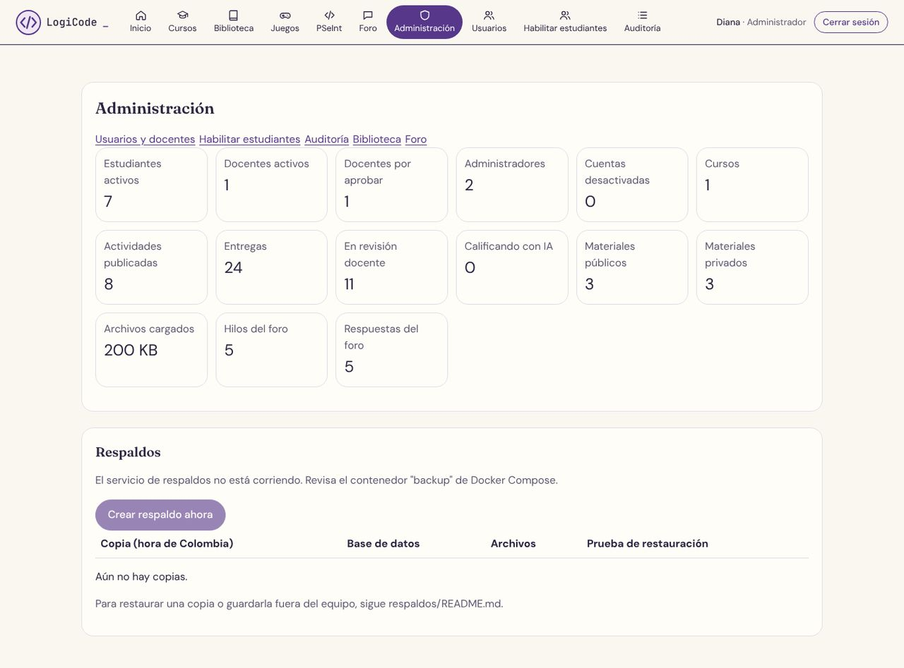

# Manual del administrador · LogiCode

Para quien tiene una cuenta **Administrador** en LogiCode: aprueba docentes, gestiona cuentas, habilita estudiantes, revisa la auditoría, cuida la biblioteca y el foro, y vigila los respaldos. La instalación y el equipo servidor están en el [manual técnico](manual-tecnico.md) y en [instalación](../instalacion.md).

## 1. Dos tipos de cuenta Administrador

| | Cuentas iniciales | Demás cuentas Administrador (ordinarias) |
| --- | --- | --- |
| Quiénes | Dos: Carlos Alberto Escamilla Mariño y Yarly Melitza Guerrero Berbesi | Las que una cuenta inicial pasa al rol Administrador |
| Cómo se crean | Al arrancar el servidor, con los datos del `.env` (`INITIAL_ADMIN_1_*` e `INITIAL_ADMIN_2_*`). Llegan sin contraseña: cada una confirma su correo y la crea con **¿Olvidaste tu contraseña?** ([instalación](../instalacion.md)) | Una cuenta existente (estudiante o docente) a la que una cuenta inicial le cambia el rol |
| Cómo aparecen | "Administrador (permisos completos)" | "Administrador" |
| Pueden hacer | Todo, incluido cambiar roles, crear contenido, calificar y responder actividades | Tareas administrativas: usuarios, docentes, habilitar estudiantes, auditoría, biblioteca, foro y respaldos. En los cursos ven todo en **solo lectura** |
| No pueden | Desactivar o quitarle el rol a la última cuenta inicial activa (la plataforma lo impide) | Cambiar roles; crear temas, materiales o actividades; calificar o corregir notas; responder actividades o quizzes; desactivar o activar una cuenta inicial |

El privilegio completo no es un rol: es una marca que solo tienen las dos cuentas iniciales y que ninguna pantalla ni endpoint puede dar a otra cuenta. El detalle de cada permiso está en [permisos.md](../permisos.md). En **Mi cuenta** (tu nombre, arriba a la derecha) aparece "Lo que puedes hacer" con la lista de tus permisos.

## 2. Menú

La barra superior tiene iconos y muestra solo lo que tu cuenta puede usar: **Inicio, Cursos, Biblioteca, Juegos, PSeInt, Foro, Administración, Usuarios, Habilitar estudiantes, Auditoría**. En el celular la barra se desliza de lado.

## 3. Panel de administración

**Administración** (`/admin`) muestra accesos rápidos (**Usuarios y docentes, Habilitar estudiantes, Auditoría, Biblioteca, Foro**) y las cifras de la plataforma:

| Cifra | Qué cuenta |
| --- | --- |
| Estudiantes activos, Docentes activos, Administradores | Cuentas activas de cada rol |
| Docentes por aprobar | Solicitudes de cuenta docente que esperan tu aprobación |
| Cuentas desactivadas | Cuentas que no pueden ingresar |
| Cursos, Actividades publicadas, Entregas | Uso de la plataforma |
| En revisión docente | Entregas que esperan que un docente las califique |
| Calificando con IA | Entregas en la cola de la IA. Si este número no baja, avisa a quien maneja el servidor ([manual técnico](manual-tecnico.md#9-problemas-frecuentes)) |
| Materiales públicos, Materiales privados, Archivos cargados | Contenido de la biblioteca y espacio que ocupan los archivos |
| Hilos del foro, Respuestas del foro | Actividad del foro |

*Panel de administración. En esta captura, tomada en un equipo de desarrollo, el servicio de respaldos no estaba corriendo, por eso aparece el aviso y el botón está desactivado.*

## 4. Usuarios y docentes

**Usuarios** lista todas las cuentas con cédula, nombre, correo (con la marca "sin verificar" si aún no lo confirmó), rol, estado y acciones. Filtros: **Buscar** (cédula, nombre o correo), **Rol** y **Estado** (Pendiente de aprobación, Activa, Desactivada).

| Tarea | Cómo | Quién |
| --- | --- | --- |
| Aprobar un docente | Filtro Estado = "Pendiente de aprobación" → **Aprobar**. La cuenta queda activa y el docente ya puede ingresar | Toda cuenta Administrador |
| Desactivar una cuenta | **Desactivar**. Se cierran sus sesiones abiertas y no puede volver a ingresar ("Tu cuenta está desactivada. Comunícate con un administrador.") | Toda cuenta Administrador, salvo sobre una cuenta inicial |
| Reactivar una cuenta | **Activar** en una cuenta desactivada | Igual que desactivar |
| Cambiar el rol | Lista desplegable en la columna Rol. Se cierran las sesiones abiertas de esa cuenta | Solo las cuentas iniciales |

No hay botón para rechazar una solicitud docente: queda en "Pendiente de aprobación" y esa persona no puede ingresar mientras tanto. Tampoco se crean cuentas desde aquí: cada estudiante se registra con **Registrarme como estudiante** (con su cédula habilitada) y cada docente con **Solicitar cuenta de docente**, ambos en la página de inicio.

Tu propia cuenta no muestra **Desactivar**.

## 5. Habilitar estudiantes

Un estudiante solo puede registrarse si su cédula está habilitada (lo hace también el docente desde su curso con **Importar lista**).

**Habilitar estudiantes** tiene dos formas:

- Una a una: **Cédula**, **Nombre (opcional)** → **Habilitar**.
- **Importar desde Excel o CSV**: una fila por estudiante. En Excel (`.xlsx`, primera hoja), la cédula en la columna A y el nombre, opcional, en la B. En CSV, `cedula` o `cedula,nombre` (también con punto y coma). Puede tener encabezado. Máximo 2000 filas y 1 MB. Al terminar dice cuántas se habilitaron, cuántas ya estaban y qué filas tienen errores.

La tabla **Cédulas habilitadas** muestra cada cédula con su nombre, cuándo se habilitó y si ya está "Registrado" o sigue "Pendiente".

## 6. Auditoría

**Auditoría** lista, de la más reciente a la más antigua y de 50 en 50, los eventos de seguridad con su fecha en hora de Colombia, la acción, el sujeto (cédula), el resultado (Éxito, Fallo, Denegado, Límite alcanzado) y el detalle.

Acciones registradas: inicio y cierre de sesión, registro de estudiante, solicitud y aprobación de docente, cambio de rol, cambio de estado, verificación de correo enviada y confirmada, recuperación y restablecimiento de contraseña, cambio de contraseña, cambio de correo solicitado, estudiantes habilitados y administrador inicial verificado.

Úsala para revisar intentos fallidos (cinco en 15 minutos bloquean la cédula ese tiempo), cambios de rol y desactivaciones. No guarda contraseñas ni enlaces de un solo uso.

## 7. Biblioteca

Con sesión de Administrador, **Biblioteca** muestra todos los materiales, públicos y privados, con filtros **Buscar**, **Herramienta**, **Tema** y **Tipo**. En cada material:

- **Hacer público** o **Hacer privado**: un material público lo ve cualquier visitante; uno privado, solo los inscritos en su curso, su docente y las cuentas Administrador.
- **Archivar**: deja de mostrarse (pide confirmación).

Subir, editar o crear materiales y temas es del docente del curso (y de las cuentas iniciales); una cuenta Administrador ordinaria no lo hace.

## 8. Foro

Las cuentas Administrador moderan cualquier hilo, igual que los docentes: **Fijar arriba** / **Soltar**, **Cerrar a respuestas** / **Reabrir**, **Eliminar hilo** y **Eliminar respuesta**. La plataforma guarda quién eliminó cada mensaje.

## 9. Cursos en solo lectura

Una cuenta Administrador ordinaria ve todos los cursos con sus temas, actividades, la bandeja **Por revisar**, la **Planilla** (y puede exportarla con **Exportar a Excel (.xlsx)** o **Exportar a CSV**), el banco de preguntas y los intentos de quizzes, y puede inscribir o retirar estudiantes en **Estudiantes**. No ve botones para calificar, crear ni publicar. El detalle de cada pantalla está en el [manual del docente](manual-docente.md).

## 10. Respaldos

La sección **Respaldos** del panel muestra el horario de la copia diaria (hora de Colombia), cuántos días se conservan y la lista de copias con su base de datos, sus archivos y el resultado de la prueba de restauración: **Restauración probada**, **Falló la prueba de restauración** o **Sin probar**.

- **Crear respaldo ahora** pide una copia inmediata (por ejemplo, antes de una actualización). Mientras corre dice "Respaldo en curso…".
- Si aparece "El servicio de respaldos no está corriendo", el botón queda desactivado: avisa a quien maneja el servidor.
- Descargar una copia, sacarla del equipo o restaurarla **no** se hace desde la web: se hace por consola en el equipo servidor ([respaldos/README.md](../../respaldos/README.md) y [manual técnico](manual-tecnico.md#6-respaldos-y-restauración)).
- Si una copia falla, no borres las anteriores y pide una nueva.

## 11. Lo que no está en la web

| Necesidad | Dónde se resuelve |
| --- | --- |
| Crear una cuenta | Cada persona se registra o solicita su cuenta desde la página de inicio |
| Dar el privilegio completo a otra cuenta | No es posible: solo lo tienen las dos cuentas iniciales del `.env` |
| Restaurar o descargar respaldos | Consola del equipo servidor ([respaldos/README.md](../../respaldos/README.md)) |
| Encender la IA o el correo real (Brevo) | Configuración del servidor ([instalación](../instalacion.md)) |
| Una persona perdió el acceso a su correo | Ella misma usa **¿Ya no tienes acceso a tu correo?** en **Ingresar**, con su cédula, el último correo registrado y su contraseña actual o anterior ([manual del estudiante](manual-estudiante.md)) |
