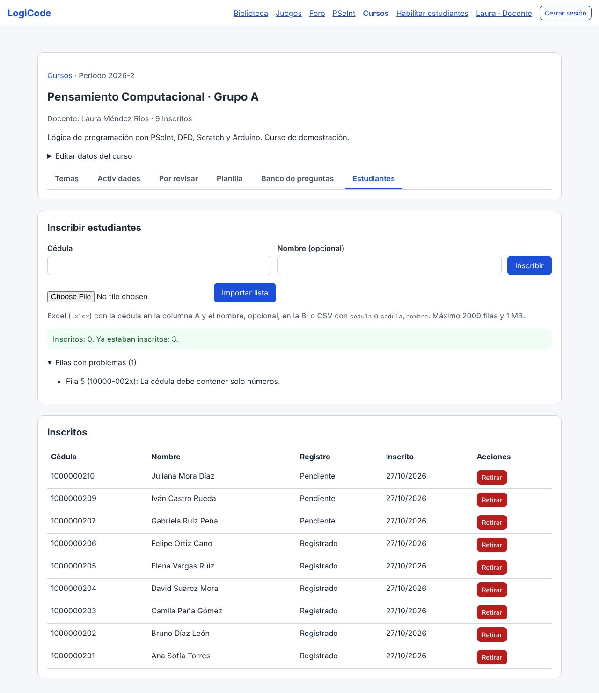
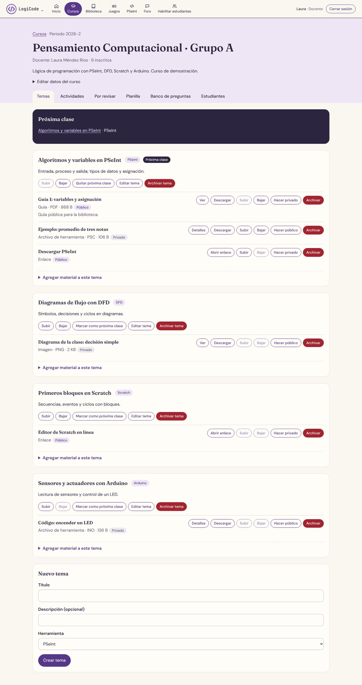
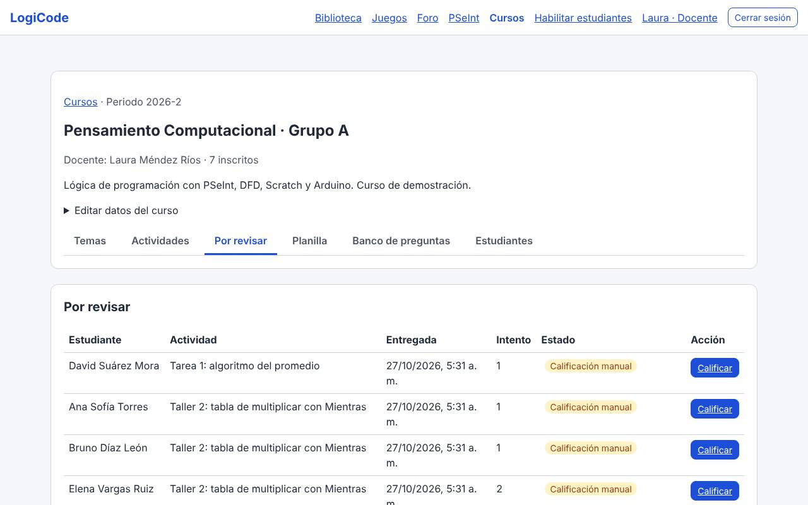
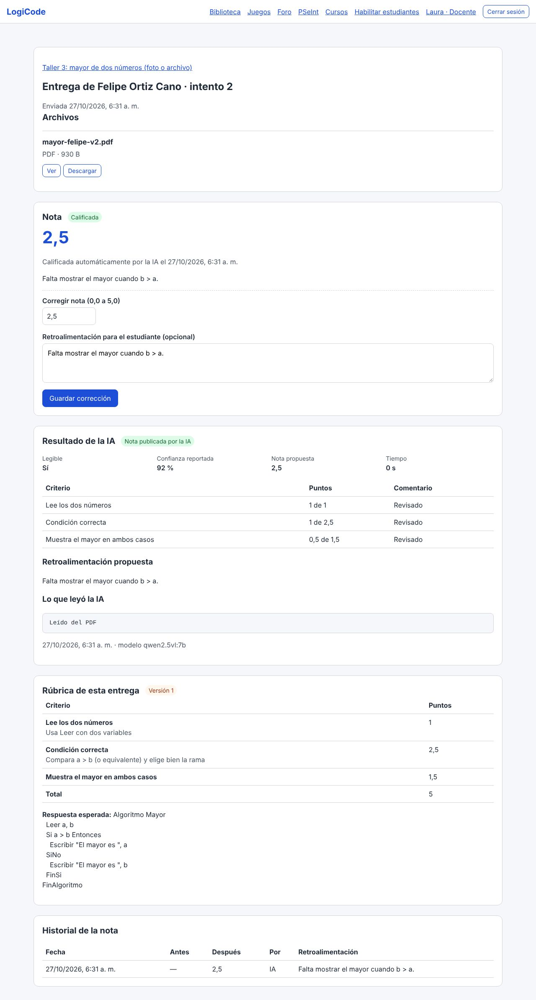
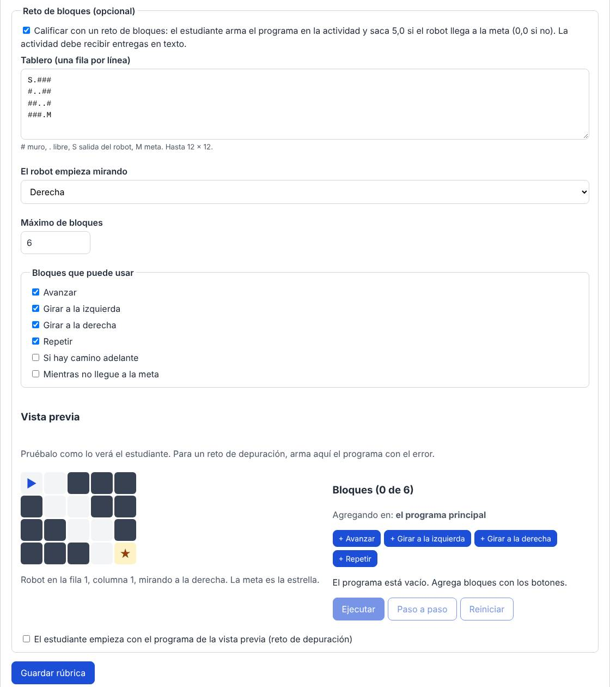
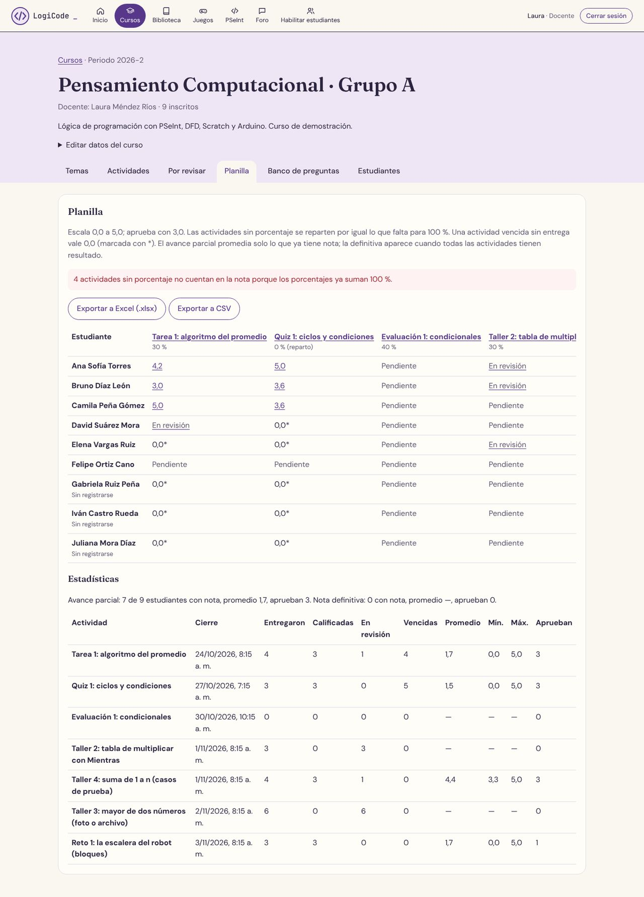

# Manual del docente · LogiCode

LogiCode reúne el curso de Pensamiento Computacional: temas y materiales, actividades con rúbrica, entregas, calificación (manual, automática con casos de prueba y quizzes, y con IA), planilla de notas y foro. Este manual sigue el orden en que se prepara y se lleva un curso.

## 1. Tu cuenta de docente

1. En la página de inicio, **Solicitar cuenta de docente**: cédula, nombre, correo y contraseña (mínimo 8 caracteres, con al menos un número y un carácter especial).
2. Confirma el correo con el enlace que llega.
3. Una cuenta Administrador aprueba la solicitud. Hasta entonces no puedes ingresar.
4. Entra con **Iniciar sesión** (arriba a la derecha): cédula y contraseña → **Ingresar**. En **Mi cuenta** (tu nombre, arriba a la derecha) cambias la contraseña; al hacerlo se cierran todas tus sesiones.

La barra superior tiene un icono por opción: **Inicio, Cursos, Biblioteca, Juegos, PSeInt, Foro** y **Habilitar estudiantes**. En el celular se desliza de lado. Dentro de un curso, las secciones son **Temas, Actividades, Por revisar, Planilla, Banco de preguntas** y **Estudiantes**.

## 2. Crear el curso e inscribir estudiantes

1. **Cursos** → **Crear curso**: nombre, periodo (por ejemplo `2026-2`) y descripción.
2. En el curso, sección **Estudiantes**:
   - **Inscribir estudiantes**: **Cédula** y **Nombre (opcional)** → **Inscribir**, uno a la vez.
   - **Importar lista**: un archivo de Excel (`.xlsx`) con la cédula en la columna A y el nombre, opcional, en la B (puede tener encabezado), o un CSV con `cedula` o `cedula,nombre`. Hasta 2000 filas. Al terminar, la página dice cuántos se inscribieron, cuántos ya estaban y qué filas tienen errores. Hay una plantilla en `datos-demo/muestras/lista-estudiantes.xlsx`.

   

   *Importar la lista desde Excel. Captura tomada antes del rediseño visual; los textos y pasos son los mismos.*
3. Inscribir una cédula también la **habilita** para registrarse. La lista muestra quién ya se registró ("Registrado") y quién no ("Pendiente"). **Retirar** saca a un estudiante del curso.
4. Comparte con el grupo la dirección de LogiCode y el [manual del estudiante](manual-estudiante.md).

## 3. Temas y materiales

- **Nuevo tema** (al final de la sección **Temas**): título, descripción y herramienta (PSeInt, DFD, Scratch, Arduino o General).
- En cada tema: **Agregar material a este tema** con un archivo (PDF, Word, PowerPoint, imágenes, MP4/MOV, `.psc`, `.ino`, `.sb3`; hasta 500 MB, videos hasta 1 GB) o un enlace.
- Cada material es **Privado** (solo el curso) o **Público** (también en la Biblioteca, sin cuenta). Se cambia con "Hacer público" / "Hacer privado".
- **Marcar como próxima clase** pone el tema arriba para los estudiantes. **Subir** y **Bajar** ordenan temas y materiales.
- **Archivar tema** (en el tema) o **Archivar** (en el material) lo oculta sin borrar el archivo, que se conserva al menos seis meses. Pide confirmación.

## 4. Actividades

### Crear y publicar

1. Sección **Actividades** → **Nueva actividad**: título, enunciado, tipo (Tarea, Taller, Evaluación, Quiz calificable o Quiz de repaso), porcentaje de la nota (opcional), intentos, apertura y cierre (hora de Colombia) y formas de entrega (Texto, Archivos, Fotos del trabajo hecho a mano).
2. Se crea como **borrador**, que solo tú ves.
3. Abre la actividad → **Definir rúbrica** (después dice **Editar rúbrica**): criterios con sus puntos y la respuesta esperada. La nota se lleva a la escala de 0,0 a 5,0. La IA y tú califican con ella.
4. Pulsa **Publicar**. Sin rúbrica no se puede publicar.

Cambiar la rúbrica después crea una **versión nueva**: cada entrega guarda la versión con la que se calificó.

### Porcentajes

Las actividades con porcentaje pesan eso en la nota; las que no tienen se reparten por igual lo que falta para 100 %. Si los porcentajes ya suman 100 %, las demás quedan en 0 % y la planilla lo avisa. Los quizzes de repaso y los borradores no cuentan.

### Plazos e intentos por estudiante

En la actividad, tabla **Entregas de los estudiantes** → **Plazo e intentos** de un estudiante: nuevo plazo, intentos adicionales y el motivo. Sirve para una incapacidad o para reabrir una actividad vencida (sin excepción, vencida sin entrega vale 0,0).

## 5. Calificar

La sección **Por revisar** del curso lista las entregas que esperan tu nota, con el motivo: calificación manual, foto ilegible, confianza baja de la IA, formato que la IA no lee, programa que no se pudo ejecutar o fallo técnico.

1. **Calificar** abre la entrega: respuesta, archivos (con vista previa), la rúbrica de esa entrega y, si pasó por la IA, lo que leyó, la nota propuesta por criterio y su confianza.
2. Escribe la nota (0,0 a 5,0, con un decimal) y la retroalimentación → **Publicar nota** (o **Confirmar nota** si la IA ya propuso una).
3. Para cambiar una nota publicada, ábrela, escribe la nueva en **Corregir nota** y pulsa **Guardar corrección**. El historial de la nota queda en la entrega y el estudiante ve la última.

### Calificación automática

| Tipo | Cómo se califica |
| --- | --- |
| Quiz calificable | Al enviar el intento, por los puntos de cada pregunta (nota de 0 a 5) |
| Taller de PSeInt con casos de prueba | En **Editar rúbrica**, "Casos de prueba de PSeInt": entradas y salida esperada de cada caso. Cada entrega con programa (texto o `.psc`) se ejecuta y la nota es 5 × casos aprobados / total. Si el programa no se puede ejecutar, va a Por revisar. En la entrega, **Ejecutar casos de prueba** muestra el detalle |
| Reto de bloques | En **Editar rúbrica**, "Reto de bloques (opcional)" (ver abajo). Cada entrega se vuelve a ejecutar: 5,0 si el robot llega a la meta y 0,0 si choca o no llega, con la razón como retroalimentación |
| Fotos y archivos con IA | Si la IA está activa (la enciende quien maneja el servidor), lee fotos PNG/JPG, texto, archivos `.psc`/`.ino` y PDF de hasta 5 páginas con la rúbrica. Publica sola solo si leyó bien y su confianza es de 80 % o más; si no, la entrega te llega con su propuesta. Word, PowerPoint, video y los PDF largos, dañados o con contraseña van siempre a tu revisión. Un fallo técnico no pone nota: **Reintentar con IA** la vuelve a mandar |

### Entregas en PDF leídas por la IA

De un PDF de hasta 5 páginas la IA recibe el texto que traiga (un PDF exportado desde Word o PSeInt) y cada página como imagen (un escaneo o una foto convertida a PDF). En la entrega ves lo que leyó y su propuesta por criterio, igual que con una foto.

*Entrega en PDF calificada por la IA. Captura de una prueba con un modelo simulado (modelo-simulado), no con Qwen2.5-VL real: la página muestra el nombre `qwen2.5vl:7b` porque es el modelo configurado, pero la respuesta, la confianza y el tiempo de 0 s vienen del simulador. También es anterior al rediseño visual. Las pruebas de aceptación con el modelo real siguen **pendientes**.*

### Retos de bloques

1. Crea la actividad con la forma de entrega **Texto** (y sin archivos ni fotos, que no se usan).
2. En **Definir rúbrica** o **Editar rúbrica**, sección "Reto de bloques (opcional)", marca "Calificar con un reto de bloques…".
3. Dibuja el **tablero**, una fila por línea: `#` muro, `.` libre, `S` salida del robot y `M` meta (hasta 12 × 12, todas las filas del mismo largo).
4. Elige hacia dónde **El robot empieza mirando**, el **Máximo de bloques** y los **Bloques que puede usar**.
5. Prueba el reto en la **vista previa**. Para un reto de depuración, arma ahí un programa con un error y marca "El estudiante empieza con el programa de la vista previa (reto de depuración)".
6. Pon al menos un criterio (por ejemplo "El robot llega a la meta", 5 puntos), guarda y publica.

El estudiante arma el programa en la misma actividad y lo envía. En la entrega ves el programa con sangría y, en la rúbrica, el tablero para probarlo. Un programa con bloques no permitidos o con más bloques del máximo te llega a Por revisar. Una actividad usa casos de prueba o reto de bloques, no los dos.

A la IA se envían el nombre del estudiante, el archivo, el enunciado, la rúbrica y la escala; nunca la cédula ni el correo. La IA corre en el equipo servidor y no envía nada a Internet.

## 6. Quizzes

1. Sección **Banco de preguntas** → **Nueva pregunta**: selección única, selección múltiple, falso o verdadero o respuesta corta (con las respuestas aceptadas), puntos y una explicación opcional para la revisión.
2. Crea una actividad de tipo **Quiz calificable** o **Quiz de repaso**. En su sección **Quiz** elige las preguntas del banco (el orden es en el que las marcas) y el **Tiempo total (minutos)**, y pulsa **Guardar quiz**.
3. Pon la rúbrica y publícala como cualquier actividad.

Cuando alguien ya respondió, las preguntas y el tiempo no cambian. El **ranking** ordena por nota y luego por menor tiempo. El de repaso no da nota y muestra la explicación al terminar.

## 7. Planilla y estadísticas

La sección **Planilla** muestra una columna por actividad calificable publicada, con su porcentaje y el estado de cada nota; el **avance parcial** (promedio con pesos de lo que ya tiene nota) y la **nota definitiva** (cuando todo tiene resultado) van por separado. `0,0*` es una actividad vencida sin entrega.

- **Exportar a Excel (.xlsx)** descarga la misma tabla con las notas como números, lista para ordenar o promediar en Excel. **Exportar a CSV** la da en texto, por si otro programa lo necesita.
- **Estadísticas**: por actividad (entregas, calificadas, en revisión, vencidas, promedio, mínima, máxima y aprobados) y del curso.
- Cada estudiante ve solo su fila en "Mis notas".

## 8. Foro

En **Foro** respondes como cualquier usuario y, como docente, moderas: dentro de un hilo, **Fijar arriba** / **Soltar**, **Cerrar a respuestas** / **Reabrir** o **Eliminar hilo** / **Eliminar respuesta**. Lo eliminado deja de verse y queda registrado quién lo hizo.

## 9. Otras herramientas

- **PSeInt** (menú): el mismo intérprete que califica; útil para preparar los casos de prueba.
- **Juegos** (menú): seis juegos de práctica con 99 niveles para recomendar en clase; no dan nota y no piden cuenta. El catálogo se filtra por **Herramienta** y **Tema** (detalle en el [manual del estudiante](manual-estudiante.md#8-juegos)). Los niveles de los juegos vienen con la plataforma y **no** se editan desde la web; para un reto con nota, usa el reto de bloques de la rúbrica (sección 5).
- **Biblioteca** (menú): los materiales públicos de todos los cursos.

## 10. Recomendaciones para el piloto

- Publica primero una actividad corta de prueba para que el grupo practique entregar.
- Pide fotos claras: una foto ilegible siempre termina en tu bandeja.
- Revisa **Por revisar** al final de cada clase.
- Anota cualquier problema (hora, pantalla, captura) en el registro de observaciones de [docs/piloto.md](../piloto.md).
