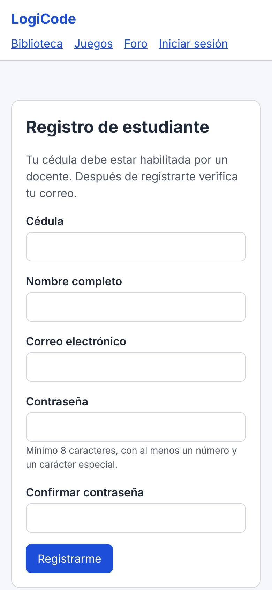
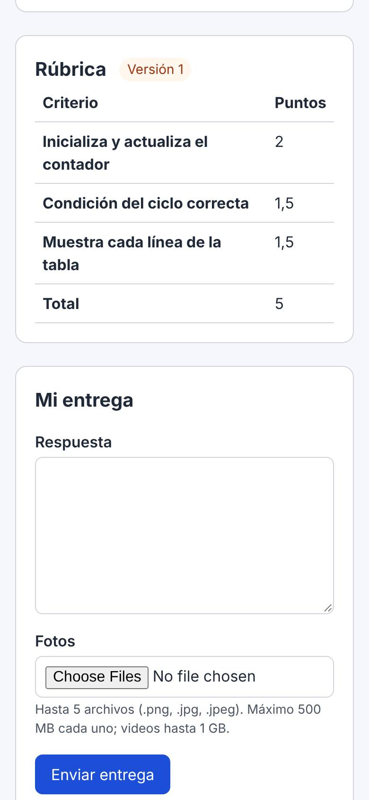
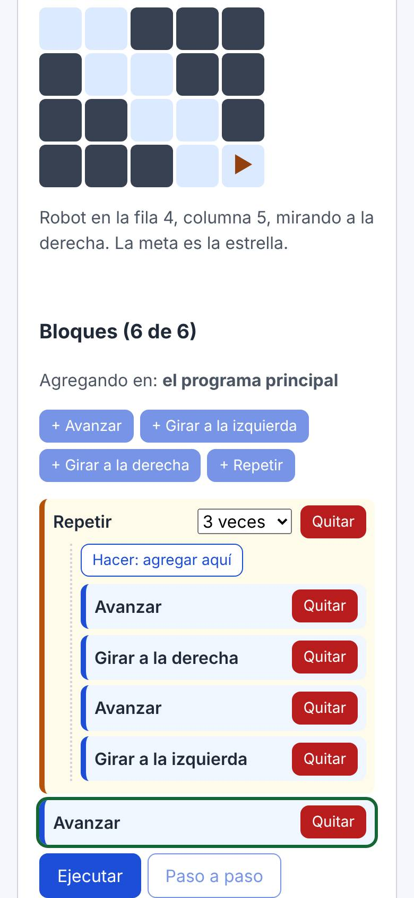
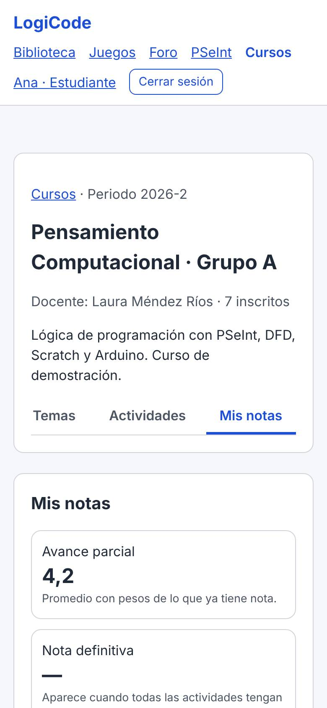

# Manual del estudiante · LogiCode

LogiCode es la plataforma del curso de Pensamiento Computacional. Ahí encuentras los temas y materiales, entregas tus actividades, presentas quizzes, practicas con juegos y PSeInt, preguntas en el foro y ves tus notas. Funciona en el computador y en el celular.

## 1. Entrar por primera vez

Tu docente te da la dirección de LogiCode (por ejemplo `https://192.168.1.50`) y habilita tu cédula en el curso. Sin ese paso no te puedes registrar.

**Si el navegador muestra "La conexión no es privada"**: durante el piloto, LogiCode usa un certificado propio del equipo de la Universidad. Si tu docente te dio el archivo `logicode-ca.crt`, instálalo como te indique; si no, pulsa "Configuración avanzada" y "Continuar". Hazlo solo con la dirección que te dio tu docente.

1. En la página de inicio, pulsa **Registrarme como estudiante**.
2. Escribe tu cédula, tu nombre completo, tu correo y una contraseña de **mínimo 8 caracteres con al menos un número y un carácter especial** (por ejemplo `#`, `*` o `!`).
3. Revisa tu correo y abre el enlace **Confirmar correo** (vence en 24 horas). Confirmarlo es lo que te permite recuperar la contraseña si la olvidas.
4. Pulsa **Iniciar sesión** y entra con tu **cédula** y tu contraseña.

Si dice que tu cédula no está habilitada, pídele a tu docente que la agregue al curso.

## 2. Tu cuenta

En el menú, tu nombre abre **Mi cuenta**: ahí ves tus datos y lo que puedes hacer, reenvías el correo de verificación y cambias tu contraseña. **Al cambiarla se cierran todas tus sesiones**, también las del celular.

- **Olvidé mi contraseña**: en Iniciar sesión, "¿Olvidaste tu contraseña?". Escribe tu correo verificado y abre el enlace que llega. El enlace vence en 60 minutos, sirve una sola vez y puedes pedirlo máximo dos veces al día.
- **Ya no uso ese correo**: en Iniciar sesión, "¿Ya no tienes acceso a tu correo?". Escribe el último correo que registraste y tu contraseña actual (o la anterior, si es la que recuerdas) y el correo nuevo. Te llega un enlace al correo nuevo; hasta que lo confirmes sigue valiendo el anterior.
- Cierra sesión con **Cerrar sesión** cuando uses un computador compartido.

## 3. Tu curso

**Cursos** → el nombre de tu curso. Tiene tres secciones:

| Sección | Qué hay |
| --- | --- |
| **Temas** | Los temas de PSeInt, DFD, Scratch y Arduino con sus materiales. El tema marcado **Próxima clase** va primero. "Ver" abre el material en la página (PDF, imágenes, video); "Descargar" lo guarda |
| **Actividades** | Tareas, talleres, evaluaciones y quizzes con su cierre, su porcentaje y en qué vas |
| **Mis notas** | Tus notas, tu avance parcial y tu nota definitiva |

La **Biblioteca** del menú tiene los materiales públicos, que cualquiera puede ver sin cuenta.

## 4. Entregar una actividad

1. En **Actividades**, abre la actividad. Arriba ves la apertura, el cierre, el porcentaje, los intentos y cómo se entrega (texto, archivos o fotos). Abajo, la **rúbrica**: lo que se va a evaluar.
2. En **Mi entrega**, escribe tu respuesta y/o adjunta tus archivos o fotos (hasta 5; máximo 500 MB cada uno y 1 GB los videos). Solo se aceptan los formatos que la actividad indica.
3. Pulsa **Enviar entrega** y espera a que la barra de carga llegue a 100 %.

Ten en cuenta:

- **Fotos del cuaderno**: con buena luz, de frente, sin sombras y con la hoja completa. Si la foto no se lee, tu entrega pasa al docente y la nota tarda más.
- **PDF**: la IA lee PDF de hasta 5 páginas y sin contraseña. Uno más largo pasa a tu docente y la nota tarda más.
- **Intentos**: si la actividad permite más de uno, puedes volver a entregar antes del cierre. **Cuenta el último intento.**
- **Cierre**: después del cierre ya no se puede entregar. Una actividad vencida sin entrega vale **0,0**, salvo que tu docente te dé un plazo nuevo (lo verás como "Ajustado por tu docente").

### Estados de una actividad

| Estado | Qué significa |
| --- | --- |
| Aún no abre | Todavía no se puede entregar |
| Pendiente | Está abierta y no has entregado |
| Calificando con IA | La inteligencia artificial está revisando tu entrega; puede tardar unos minutos |
| Entregada, en revisión | Tu docente la va a calificar |
| Calificada: 4,2 | Ya tiene nota. Ábrela para ver la retroalimentación |
| Vencida sin entrega: 0,0 | Pasó el cierre sin entrega |

Cuando la IA está activa, califica las fotos y archivos con la rúbrica y publica la nota sola solo si leyó bien tu trabajo y está segura (80 % o más). Si no, la revisa tu docente. Un fallo técnico nunca te pone nota.

## 5. Talleres de PSeInt con casos de prueba

Algunos talleres se califican solos: LogiCode ejecuta tu programa con varias entradas y revisa lo que muestra. La nota es la parte de casos que tu programa resuelve (por ejemplo, 2 de 3 casos = 3,3).

1. Escribe tu programa en **Respuesta (tu programa en PSeInt)** o adjunta tu archivo `.psc`.
2. Antes de enviar, pruébalo: escribe entradas en **Entradas para probar** (una por línea) y pulsa **Ejecutar**.
3. Pulsa **Enviar entrega**. La nota aparece en segundos. Si el programa tiene un error y no se puede ejecutar, la entrega pasa a tu docente.

En el menú, **PSeInt** abre el mismo editor para practicar cuando quieras, con ejemplos.

### Retos de bloques con nota

Algunas actividades son un reto de bloques: en **Mi entrega** aparece el tablero del robot en lugar de la caja de respuesta.

1. Agrega bloques con los botones. Para meter bloques dentro de **Repetir** o **Si**, pulsa primero "Hacer: agregar aquí"; "Volver al principal" regresa al programa principal. El reto dice cuántos bloques puedes usar.
2. Pulsa **Ejecutar** (o **Paso a paso**) para ver al robot. Puedes probar todas las veces que quieras antes de enviar.
3. Pulsa **Enviar entrega**. La nota sale sola: **5,0** si el robot llega a la meta y **0,0** si choca o no llega, con la razón. Si la actividad permite más intentos, puedes corregir y volver a enviar.

## 6. Quizzes

- **Quiz calificable**: pulsa **Empezar el quiz**. El tiempo corre desde que empiezas y **no se detiene si cierras la página**; tus respuestas se guardan mientras avanzas y, si se acaba el tiempo, el intento se envía solo con lo que tengas. La nota sale al enviar.
- **Quiz de repaso**: no da nota. Puedes repetirlo; al terminar ves qué respondiste bien y la explicación de cada pregunta.
- **Ranking**: ordena por nota y, si hay empate, por menor tiempo.

## 7. Mis notas

- La escala va de **0,0 a 5,0** y se aprueba con **3,0**.
- **Avance parcial**: el promedio, con los porcentajes de cada actividad, de lo que ya tiene nota.
- **Nota definitiva**: aparece cuando todas las actividades tienen resultado.
- Una nota con `*` es una actividad vencida sin entrega (0,0).
- La retroalimentación de cada actividad está dentro de la actividad.

## 8. Juegos

**Juegos** del menú (no necesita cuenta y no da nota): 20 niveles de bloques con un robot (secuencias, ciclos, condiciones, rutas y depuración, cada uno un poco más difícil), "¿Qué imprime?", "Ordena el algoritmo" y "Completa el DFD". Tu avance se guarda en el navegador que uses.

En el juego de bloques puedes cambiar el **personaje del robot** debajo del tablero: flecha, lápiz, cerebro o fantasma. Todos muestran hacia dónde mira el robot (el lápiz apunta con la punta; el cerebro y el fantasma miran con los ojos y tienen un triángulo en el borde de la casilla), y el texto debajo del tablero lo dice con palabras.

## 9. Foro

**Foro** del menú: preguntas y respuestas por herramienta (PSeInt, DFD, Scratch, Arduino y General). Cualquiera puede leerlo; para preguntar o responder necesitas tu cuenta.

- **Abrir un hilo**: elige la herramienta, escribe un título claro y tu pregunta (pega tu código si ayuda).
- Busca antes de preguntar: quizá alguien ya lo resolvió.
- Se muestra tu nombre, nunca tu cédula ni tu correo. No publiques datos personales ni respuestas de actividades calificables.
- Los docentes pueden fijar, cerrar o eliminar hilos y respuestas.

## 10. Problemas frecuentes

| Problema | Qué hacer |
| --- | --- |
| No me deja registrarme | Tu cédula no está habilitada: avísale a tu docente |
| "Cédula o contraseña incorrectas" varias veces | Tras 5 intentos fallidos la cuenta se bloquea 15 minutos. Espera o recupera la contraseña |
| No llega el correo | Revisa spam. Reenvíalo desde Mi cuenta o vuelve a pedir el enlace |
| No puedo subir un archivo | Revisa el formato que pide la actividad y el tamaño (500 MB, videos 1 GB) |
| La página dice que no hay conexión con el servidor | El equipo de LogiCode puede estar apagado: avísale a tu docente |
| Algo se ve mal o da error | Avísale a tu docente con una captura de pantalla y la hora |
