# Maquetas

Documento de la Etapa 1 (análisis y diseño), escrito después de construir el sistema y verificado contra el código del frontend el 2 de noviembre de 2026. Son maquetas de **baja fidelidad**: muestran la distribución de cada pantalla, sus campos y sus acciones, sin colores ni tipografía definitivos. El aspecto real (crema, lavanda y morado del rediseño con el Canva) está en el código y en las capturas de cada etapa.

Cómo leerlas:

- Las cajas grises son la estructura; las barras grises son texto de relleno; una caja con una X es una imagen, un PDF o un video.
- Los **números naranjas** se explican en la tabla que sigue a cada maqueta.
- **PC**: 1024 px de ancho. **Celular**: 375 px de ancho, que es el ancho para el que se revisó cada pantalla (RNF-01: adaptable a celular).
- Los nombres, cursos y notas son ficticios, los mismos de [datos-demo](../datos-demo/README.md). Las cédulas que aparecen son de relleno.
- Cada maqueta indica los [casos de uso](casos-de-uso.md) y las [historias de usuario](historias-de-usuario.md) que cubre.

Las maquetas se dibujan en [maquetas/fuente.html](maquetas/fuente.html) y se guardan como imagen con `node docs/maquetas/capturar.mjs` (necesita Playwright con Chromium). Para cambiar una maqueta se edita la fuente y se vuelve a ejecutar el script.

## Estado

| Qué | Estado |
| --- | --- |
| Maquetas de las 18 pantallas principales (este documento) | Implementado: cada maqueta corresponde a una pantalla que ya existe |
| Maquetas de pantallas secundarias (verificar correo, recuperar contraseña, cambiar correo, Mi cuenta, Habilitar estudiantes, Auditoría, Banco de preguntas, Estudiantes, los otros juegos) | **Pendiente**: siguen el mismo patrón de formulario o tabla que las de aquí; se dibujan si el docente o la guía las piden |
| Validación de las maquetas con el docente | **Pendiente**: se hace en el piloto ([piloto.md](piloto.md)) |

## Resumen

| Maqueta | Pantalla | Quién la usa | Dispositivo | Casos de uso | Historias |
| --- | --- | --- | --- | --- | --- |
| M-01 | Página de inicio | Visitante | PC | CU-01, CU-02 | HU-01, HU-02 |
| M-02 | Iniciar sesión | Visitante | Celular | CU-03, CU-05, CU-06 | HU-03, HU-05, HU-06 |
| M-03 | Registro de estudiante | Visitante | Celular | CU-01, CU-04 | HU-01, HU-04 |
| M-04 | Curso: Temas | Docente | PC | CU-12, CU-13 | HU-15, HU-16 |
| M-05 | Biblioteca | Visitante | PC | CU-14 | HU-17 |
| M-06 | Nueva actividad y rúbrica | Docente | PC | CU-15, CU-16 | HU-18, HU-23, HU-24 |
| M-07 | Actividad y entrega | Estudiante | Celular | CU-17 | HU-19 |
| M-08 | Por revisar | Docente | PC | CU-18, CU-20 | HU-21, HU-26 |
| M-09 | Entrega con resultado de la IA | Docente | PC | CU-18, CU-20 | HU-21, HU-22, HU-26 |
| M-10 | Mis notas | Estudiante | Celular | CU-26 | HU-33 |
| M-11 | Planilla | Docente | PC | CU-27 | HU-34 |
| M-12 | Presentar un quiz | Estudiante | Celular | CU-23 | HU-28 |
| M-13 | Editor de PSeInt | Estudiante o docente | PC | CU-24 | HU-29 |
| M-14 | Catálogo de juegos | Cualquiera | PC | CU-25 | HU-30 |
| M-15 | Juego de bloques | Cualquiera | Celular | CU-25 | HU-31 |
| M-16 | Hilo del foro | Estudiante | Celular | CU-28, CU-29 | HU-35, HU-36 |
| M-17 | Panel de administración | Administrador | PC | CU-30, CU-31 | HU-12, HU-13 |
| M-18 | Usuarios | Administrador inicial | PC | CU-08, CU-09, CU-10 | HU-08, HU-09, HU-10, HU-11 |

## Mapa de navegación

La barra superior cambia según el rol: sin sesión muestra Inicio, Biblioteca, Juegos y Foro; con sesión agrega Cursos y PSeInt; el docente agrega Habilitar estudiantes y el administrador, Administración, Usuarios y Auditoría. Ocultar un enlace es solo comodidad: el backend valida cada permiso ([permisos.md](permisos.md)).

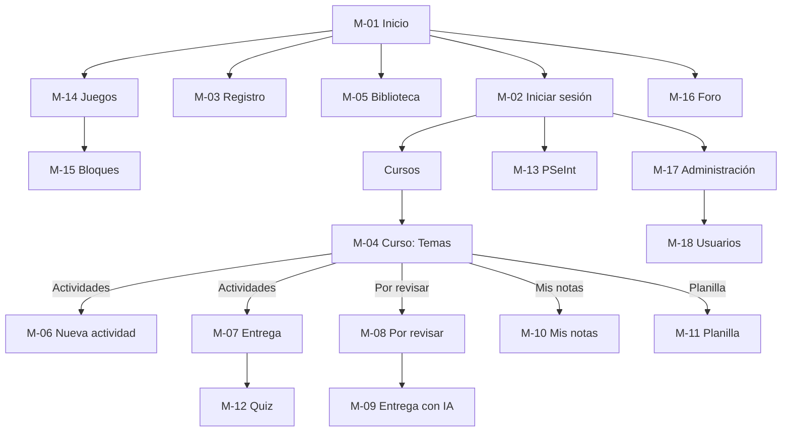

## M-01 · Página de inicio

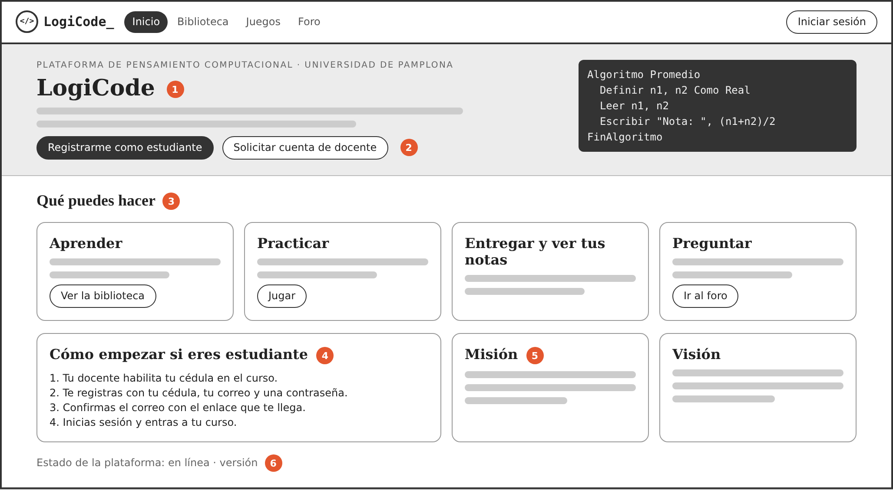

| N.º | Qué muestra |
| --- | --- |
| 1 | Nombre de la plataforma y la universidad (RF-23) |
| 2 | Las dos formas de crear cuenta: estudiante (con cédula habilitada) y solicitud de docente |
| 3 | Lo que se puede hacer sin cuenta (biblioteca, juegos, foro) y con cuenta (entregar y ver notas) |
| 4 | Pasos para que un estudiante empiece |
| 5 | Misión y visión (RF-23) |
| 6 | Estado de la plataforma y versión instalada |

## M-02 · Iniciar sesión

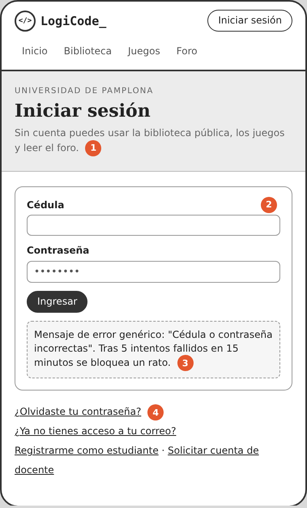

| N.º | Qué muestra |
| --- | --- |
| 1 | Aviso de lo que se puede usar sin cuenta |
| 2 | Se ingresa con la cédula, no con el correo (RF-03) |
| 3 | Mensaje genérico ante datos incorrectos; cinco intentos fallidos en 15 minutos bloquean la cédula un rato |
| 4 | Recuperar la contraseña por correo (CU-05) y recuperar el acceso cuando ya no se tiene el correo (CU-06) |

## M-03 · Registro de estudiante

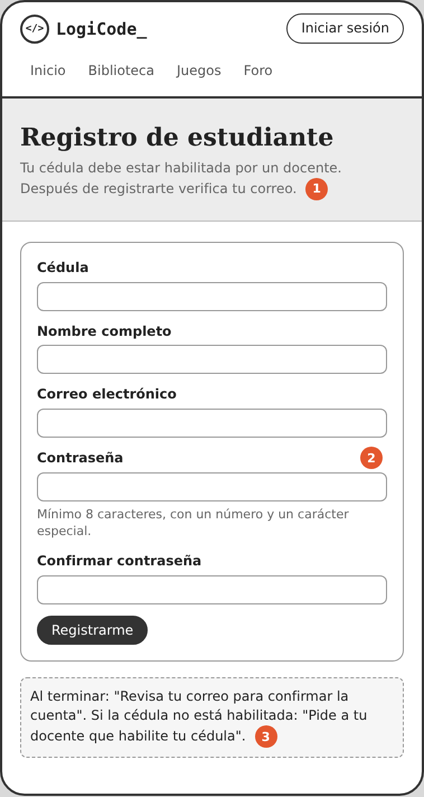

| N.º | Qué muestra |
| --- | --- |
| 1 | La cédula debe estar habilitada por un docente antes del registro (RN-01) |
| 2 | Regla de la contraseña: 8 caracteres o más, un número y un carácter especial (RNF-02) |
| 3 | Después del registro llega el enlace para confirmar el correo (CU-04); si la cédula no está habilitada, no se crea la cuenta |

La solicitud de cuenta de docente (`/registro/docente`) usa el mismo formulario y deja la cuenta "Pendiente de aprobación".

## M-04 · Curso: Temas

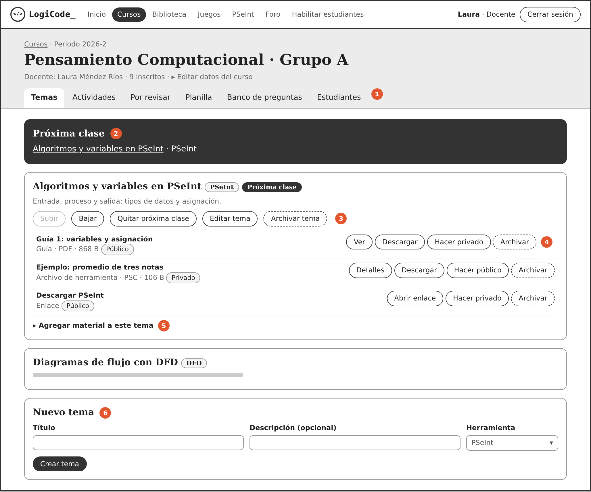

| N.º | Qué muestra |
| --- | --- |
| 1 | Pestañas del curso para el docente. El estudiante ve solo Temas, Actividades y Mis notas |
| 2 | Tema marcado como próxima clase, destacado arriba (RF-09) |
| 3 | Ordenar, editar y archivar el tema; archivar no borra |
| 4 | Cada material dice tipo, formato, tamaño y si es público o privado (RF-08); Ver abre la previsualización y Descargar baja el archivo con permisos |
| 5 | Agregar material: archivo (hasta 500 MB, videos hasta 1 GB) o enlace |
| 6 | Crear un tema con su herramienta (PSeInt, DFD, Scratch, Arduino) |

## M-05 · Biblioteca

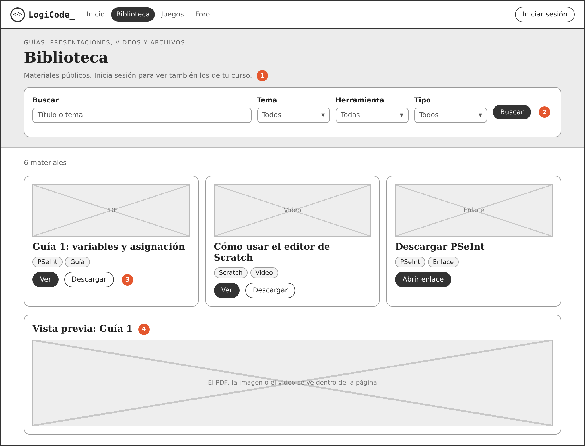

| N.º | Qué muestra |
| --- | --- |
| 1 | El visitante ve los materiales públicos; con sesión se agregan los privados de sus cursos |
| 2 | Búsqueda por texto y filtros por tema, herramienta y tipo (RF-24) |
| 3 | Cada tarjeta permite ver en la página o descargar |
| 4 | Previsualización en la página para PDF, imágenes y videos compatibles (RF-25, RN-17) |

## M-06 · Nueva actividad y rúbrica

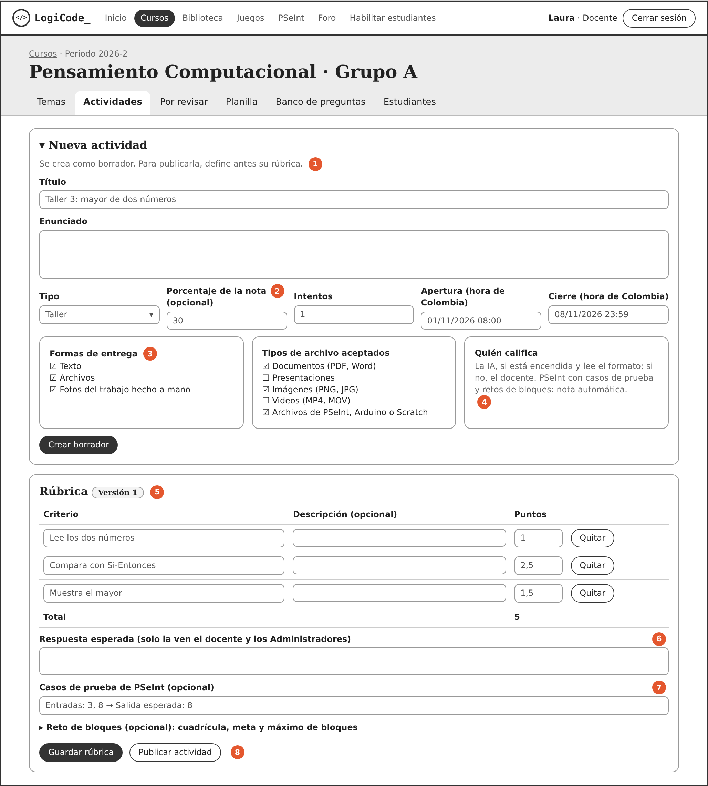

| N.º | Qué muestra |
| --- | --- |
| 1 | La actividad nace como borrador y no se publica sin rúbrica (RN-20) |
| 2 | Porcentaje opcional: las actividades sin porcentaje se reparten lo que falta para 100 % (RN-07) |
| 3 | Formas de entrega y tipos de archivo aceptados |
| 4 | No hay un selector de "quién califica": la IA califica si está encendida y lee el formato; si no, la entrega va al docente. PSeInt con casos de prueba y retos de bloques dan nota automática |
| 5 | La rúbrica tiene versión (RN-20): si cambia después de recibir entregas, cada entrega conserva la versión con la que se calificó |
| 6 | Respuesta esperada, que el estudiante no ve; la usa la IA y el docente |
| 7 | Casos de prueba de PSeInt (nota = 5 × casos aprobados ÷ total) y reto de bloques opcional (CU-16) |
| 8 | Guardar la rúbrica y publicar |

## M-07 · Actividad y entrega

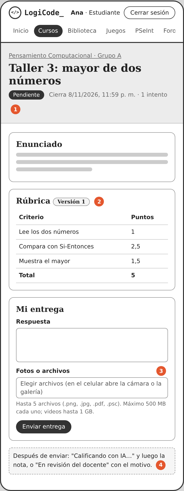

| N.º | Qué muestra |
| --- | --- |
| 1 | Situación de la actividad para el estudiante, fecha de cierre en hora de Colombia e intentos (RF-19) |
| 2 | El estudiante ve la rúbrica antes de entregar |
| 3 | Fotos o archivos según lo que aceptó el docente; en el celular el selector abre la cámara o la galería |
| 4 | Después de enviar: "Calificando con IA" y luego la nota, o "En revisión" si la revisa el docente (RF-13) |

## M-08 · Por revisar

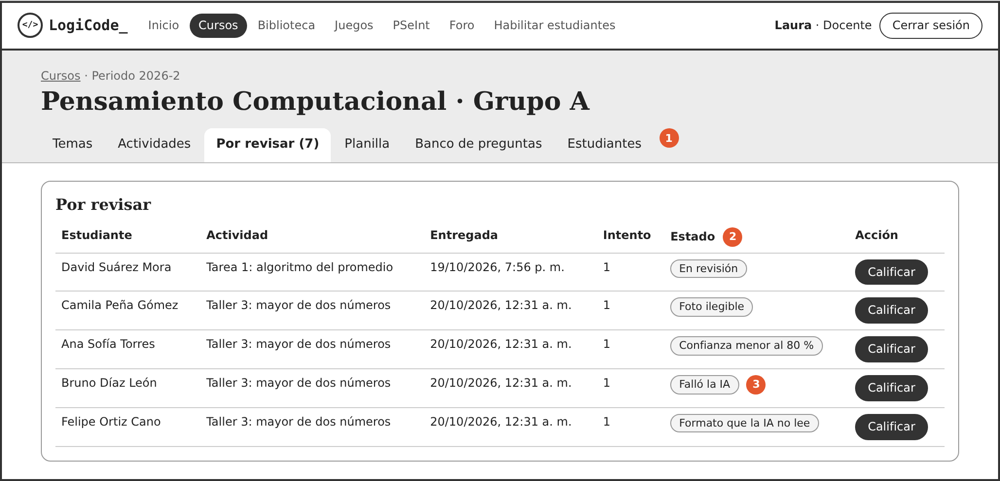

| N.º | Qué muestra |
| --- | --- |
| 1 | Pestaña con las entregas que esperan al docente |
| 2 | Motivo por el que la entrega espera: calificación manual, formato que la IA no lee, foto ilegible, confianza menor al 80 %, falló la IA o el programa no se pudo ejecutar (RF-15, RN-09, RN-11) |
| 3 | Un fallo técnico no genera nota; el docente puede reintentar o calificar |

## M-09 · Entrega con resultado de la IA

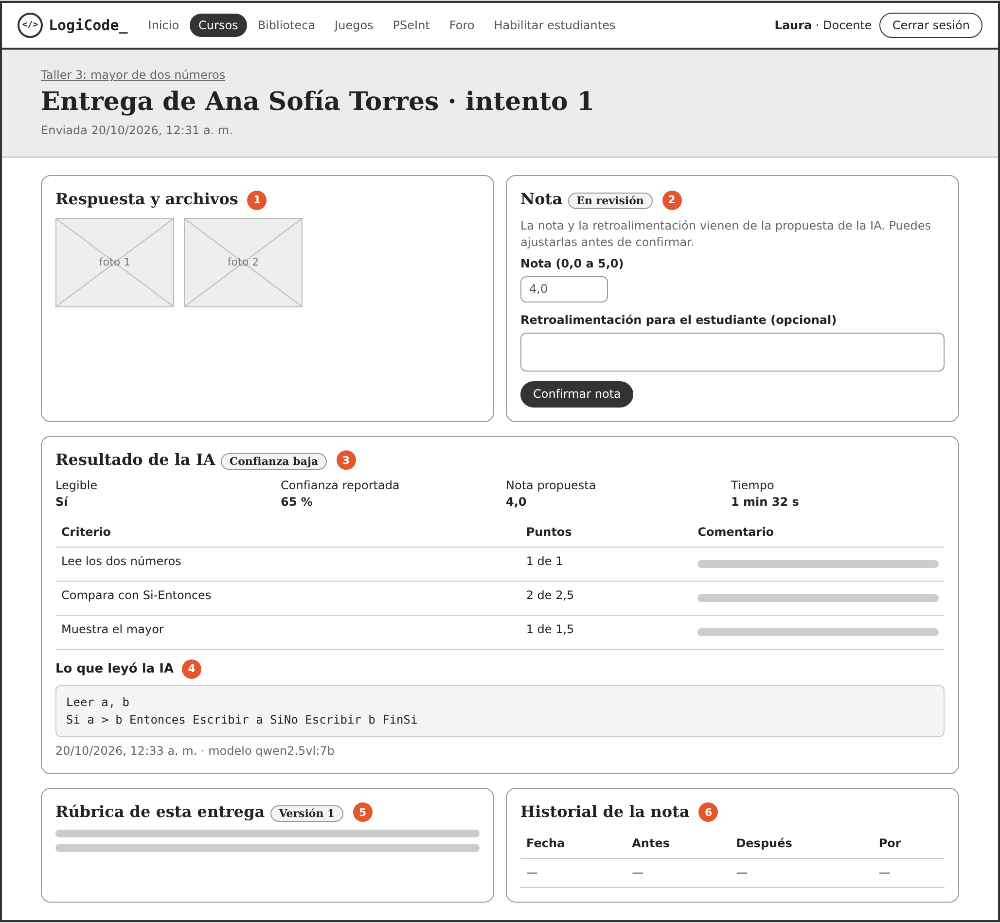

| N.º | Qué muestra |
| --- | --- |
| 1 | Lo que entregó el estudiante: texto, fotos, PDF o archivos |
| 2 | El docente confirma o ajusta la nota propuesta (0,0 a 5,0) y la retroalimentación |
| 3 | Resultado de la IA: si leyó la entrega, confianza reportada, nota propuesta, tiempo y puntos por criterio |
| 4 | Lo que la IA transcribió y el modelo que la evaluó, para que el docente lo compare |
| 5 | La versión de la rúbrica con la que se califica esta entrega |
| 6 | Historial de la nota: cada cambio queda con fecha, valor anterior, valor nuevo y quién lo hizo (docente, IA o automática) |

## M-10 · Mis notas

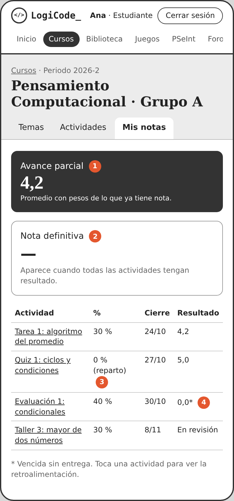

| N.º | Qué muestra |
| --- | --- |
| 1 | Avance parcial: promedio con pesos de lo que ya tiene nota |
| 2 | Nota definitiva aparte; aparece cuando todas las actividades tienen resultado |
| 3 | Actividades sin porcentaje: se reparten lo que falta para 100 % |
| 4 | Actividad vencida sin entrega = 0,0, salvo reapertura por el docente (RN-05) |

## M-11 · Planilla

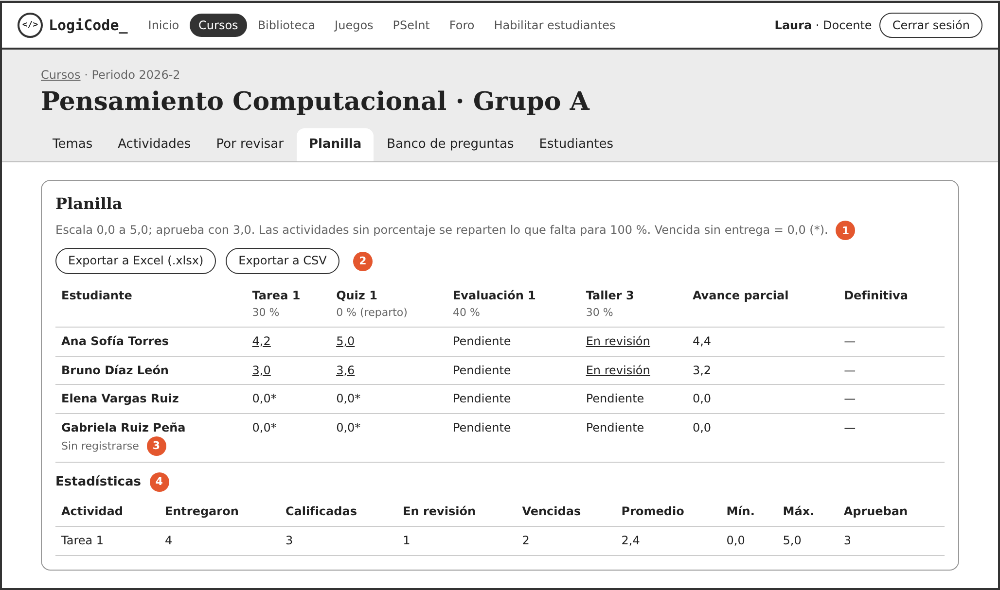

| N.º | Qué muestra |
| --- | --- |
| 1 | Reglas de la escala y del cálculo, a la vista del docente |
| 2 | Exportar a Excel (.xlsx) o CSV (RF-18, P-07) |
| 3 | Estudiante inscrito por cédula que aún no se registra |
| 4 | Estadísticas por actividad: entregas, calificadas, en revisión, vencidas, promedio, mínimo, máximo y aprobados |

## M-12 · Presentar un quiz

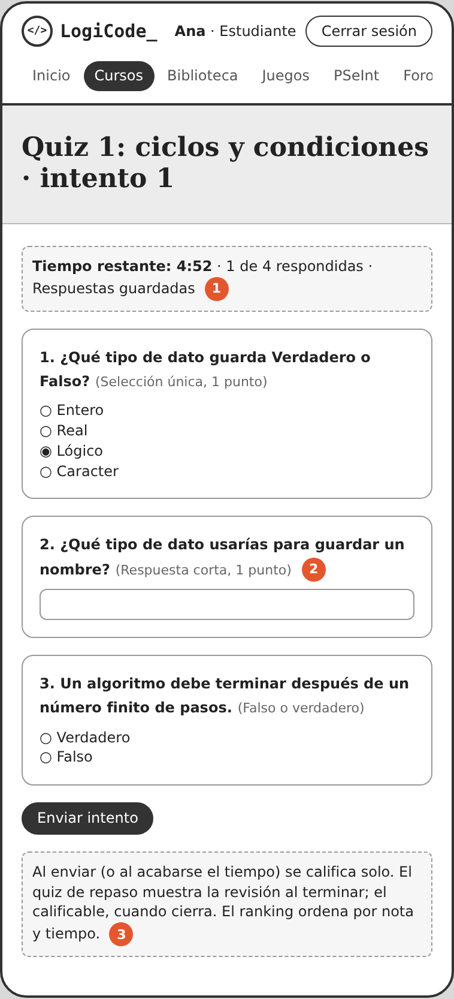

| N.º | Qué muestra |
| --- | --- |
| 1 | Tiempo restante, avance y aviso de que las respuestas se guardan solas |
| 2 | Tipos de pregunta: selección única, respuesta corta y falso o verdadero |
| 3 | Si se acaba el tiempo, el servidor envía el intento con lo guardado; revisión y ranking según el tipo de quiz (CU-23) |

## M-13 · Editor de PSeInt

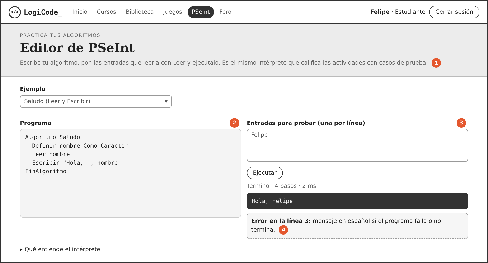

| N.º | Qué muestra |
| --- | --- |
| 1 | Es el mismo intérprete que califica las actividades con casos de prueba |
| 2 | Programa con ejemplos para empezar |
| 3 | Entradas para `Leer`, una por línea, y la salida del programa |
| 4 | Errores en español con la línea; ciclos infinitos o demasiados pasos se cortan con un mensaje |

## M-14 · Catálogo de juegos

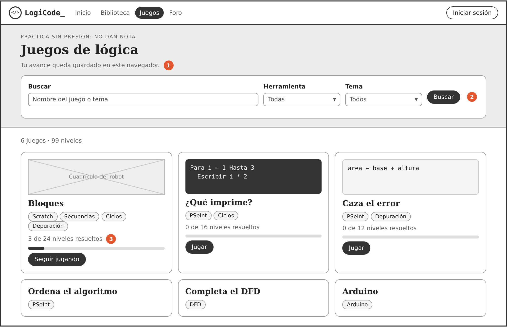

| N.º | Qué muestra |
| --- | --- |
| 1 | Los juegos no dan nota; el avance se guarda en el navegador |
| 2 | Búsqueda y filtros por herramienta y tema |
| 3 | Cada tarjeta muestra herramienta, temas y niveles resueltos |

## M-15 · Juego de bloques

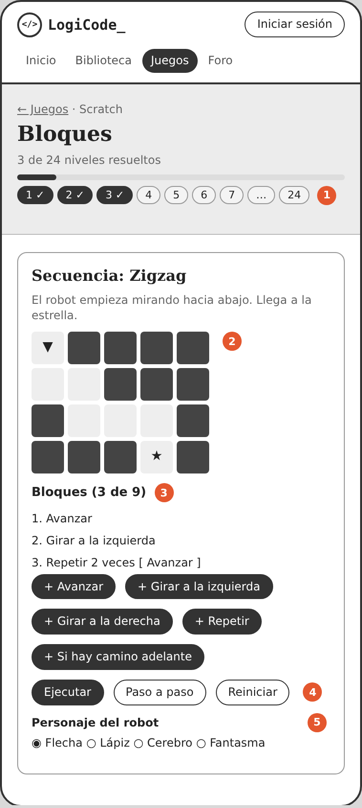

| N.º | Qué muestra |
| --- | --- |
| 1 | Niveles en orden; los resueltos quedan marcados |
| 2 | Cuadrícula con el robot, los muros y la meta |
| 3 | Programa armado con botones de bloques: secuencias, giros, ciclos y condiciones, con un máximo por nivel |
| 4 | Ejecutar, paso a paso (para depurar) y reiniciar |
| 5 | Personaje del robot |

## M-16 · Hilo del foro

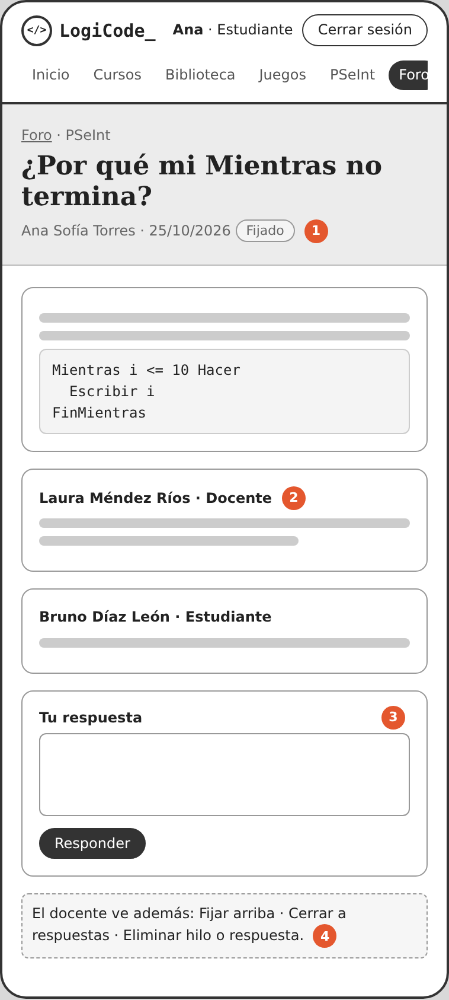

| N.º | Qué muestra |
| --- | --- |
| 1 | Herramienta del hilo y marcas de fijado o cerrado |
| 2 | Cada respuesta dice quién la escribió y su rol |
| 3 | Responder exige sesión; sin sesión el foro se puede leer |
| 4 | Moderación del docente y del administrador: fijar, cerrar y eliminar (RF-27, CU-29) |

## M-17 · Panel de administración

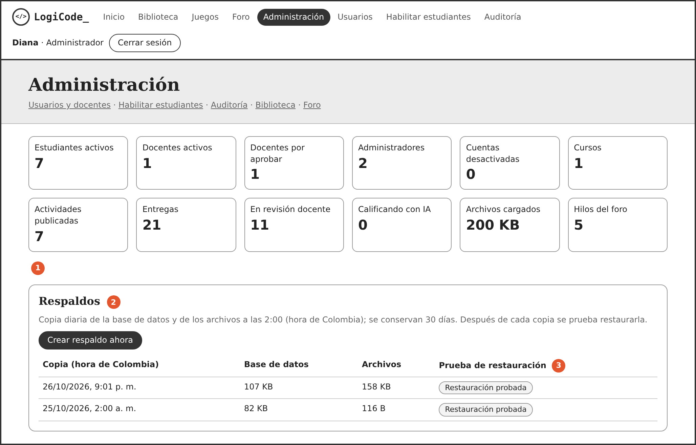

| N.º | Qué muestra |
| --- | --- |
| 1 | Cifras de la plataforma: cuentas, cursos, actividades, entregas, archivos y foro |
| 2 | Respaldo diario a las 2:00 (hora de Colombia), 30 días, y respaldo manual |
| 3 | Cada copia se prueba restaurándola y el resultado queda a la vista |

## M-18 · Usuarios

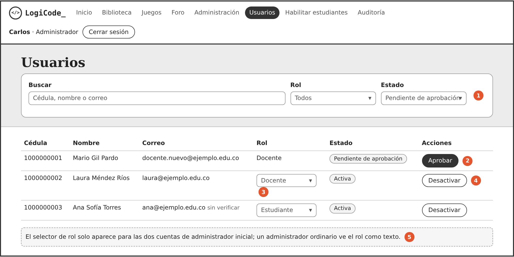

| N.º | Qué muestra |
| --- | --- |
| 1 | Búsqueda y filtros por rol y estado |
| 2 | Aprobar las solicitudes de docente |
| 3 | Cambiar el rol: solo las dos cuentas de administrador inicial (RN-04) |
| 4 | Activar o desactivar cuentas |
| 5 | Un administrador ordinario ve el rol como texto y no tiene funciones académicas (HU-11) |
