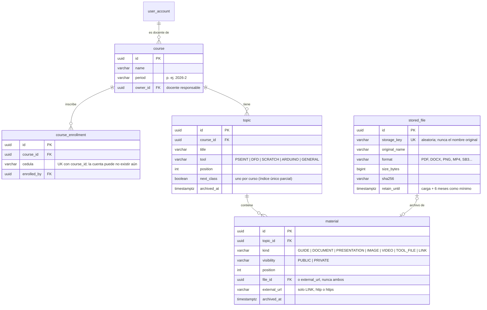
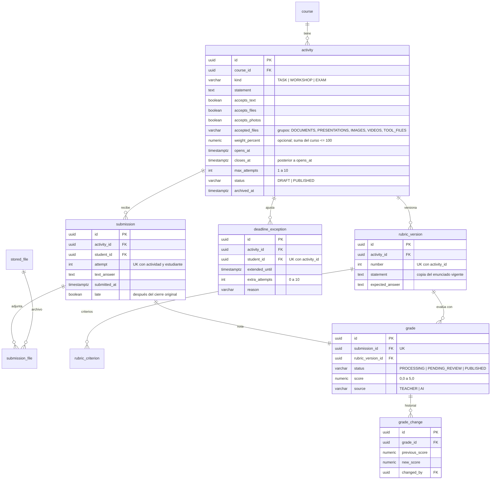
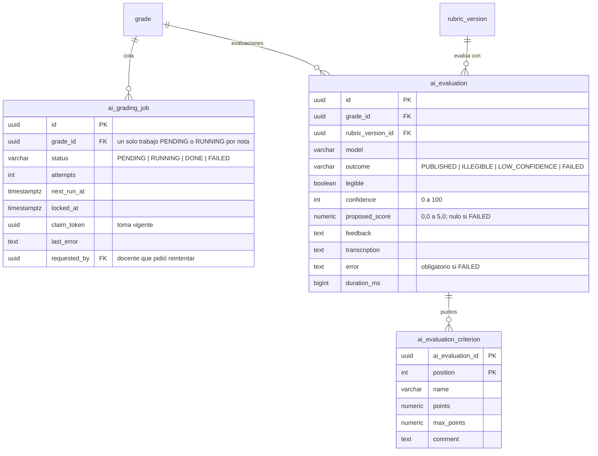

# Modelo de datos

## Convenciones (aplican desde ya)

| Tema | Convención |
| --- | --- |
| Migraciones | Flyway en `backend/src/main/resources/db/migration`, nombre `V<n>__<descripcion_en_español>.sql`. Una migración aplicada **nunca** se edita; los cambios van en una nueva |
| Nombres | Tablas y columnas en inglés, `snake_case`, tablas en singular (`user_account`, `activity`) |
| Claves | `id UUID` como clave primaria |
| Fechas | `TIMESTAMPTZ` (se guardan en UTC). Una fecha de negocio "en Colombia" se guarda como `DATE` calculada con `America/Bogota` cuando una regla la necesita |
| Notas | `NUMERIC(2,1)` con `CHECK (valor BETWEEN 0.0 AND 5.0)` |
| Porcentajes | `NUMERIC(5,2)` entre 0 y 100 |
| Enumeraciones | `VARCHAR` con `CHECK` (más simple de migrar que tipos `ENUM` de PostgreSQL) |
| Auditoría | Columnas `created_at` y `updated_at` en tablas de negocio |
| Archivos | Nunca binarios en la base de datos: solo metadatos y la clave del objeto en el almacenamiento |
| Secretos | Contraseñas y tokens solo como hash; nunca en texto plano ni en logs |

## Esquema actual (implementado)

| Migración | Contenido |
| --- | --- |
| `V1__linea_base.sql` | Línea base: no crea tablas de negocio. Flyway crea su tabla `flyway_schema_history` |
| `V2__identidad_y_acceso.sql` | Etapa 3: cuentas, tokens de un solo uso, límites de recuperación, cédulas habilitadas, auditoría y sesiones (`spring_session`, `spring_session_attributes`) |
| `V3__cursos_temas_y_biblioteca.sql` | Etapa 4: cursos, inscripciones, archivos cargados, temas y materiales |
| `V4__actividades_y_entregas.sql` | Etapa 5: actividades, entregas y sus archivos, excepciones de plazo, versiones de rúbrica con criterios, notas e historial de notas |
| `V5__calificacion_con_ia.sql` | Etapa 6: estado `PROCESSING` y motivo de revisión en las notas, cola de evaluación con IA, evaluaciones de la IA con sus puntos por criterio |

## Identidad y acceso (Etapa 3, implementado)

Cómo cubre las reglas aprobadas:

- **RNF-02 / RN-25 (dos hashes)**: al cambiar la contraseña, `previous_password_hash ← password_hash` y `password_hash ← nuevo`; el más antiguo se sobrescribe. Nunca hay texto plano.
- **RN-23 (token)**: en la base solo queda el hash del token, su vencimiento y `used_at`. Un token usado o vencido se rechaza; emitir uno nuevo invalida los anteriores sin usar del mismo propósito.
- **RN-23 / D-04 (2 por día)**: se cuentan las filas de `recovery_request` por cuenta, `kind` y `business_date` (fecha en `America/Bogota`). `LIMIT_REACHED` no suma; en cambio de correo, un intento con datos incorrectos (`REJECTED`) sí suma.
- **RN-24 / RN-25 (correo)**: hay un solo correo vigente, en `user_account.email`. Un correo nuevo espera en `one_time_token.target_email` y solo reemplaza al actual cuando se abre el enlace (T-18).
- **RN-16**: los casos de uso rechazan cualquier cambio que deje la plataforma sin una cuenta inicial activa con privilegio completo; el arranque además lo restablece (T-17).
- **D-01**: al cambiar o restablecer la contraseña se borran las filas de `spring_session` de la cuenta (el nombre del principal es el `id` de la cuenta).
- **RN-01**: el registro de estudiante exige una fila en `student_enablement` con su cédula y sin `registered_user_id`.

## Cursos, temas y biblioteca (Etapa 4, implementado)

- **RN-03 / RN-17**: un material privado solo lo ven los inscritos (por cédula), el docente responsable y las cuentas Administrador. Para los demás responde `404`.
- **RNF-04 / RN-21**: `files` comprueba la extensión permitida para el tipo de material, el tamaño (500 MB; 1 GB videos) y la firma del contenido antes de guardar.
- **RNF-12**: temas y materiales se archivan (`archived_at`); el archivo se conserva al menos hasta `retain_until`.

## Actividades, entregas y notas (Etapa 5, implementado)

- **RN-20**: cada entrega guarda en `grade.rubric_version_id` la versión vigente al enviarla; editar la rúbrica o el enunciado crea una fila nueva en `rubric_version`.
- **RN-05**: la actividad vencida sin entrega no tiene fila: el estado `OVERDUE` (0,0) se calcula al consultar (T-32).
- Las entregas y las notas no se borran; archivar la actividad solo la oculta.

## Calificación con IA (Etapa 6, implementado)

Migración `V5__calificacion_con_ia.sql`. `grade.status` admite además `PROCESSING` y `grade.review_reason` dice por qué una nota espera al docente: `AI_DISABLED`, `UNSUPPORTED`, `ILLEGIBLE`, `LOW_CONFIDENCE` o `AI_FAILED`.

- **RF-17**: cada evaluación de la IA queda guardada, incluidas las fallidas, aunque el docente califique antes o después (T-43).
- **RN-11**: un fallo técnico no deja nota: `ai_evaluation_failed_ck` exige `proposed_score` nulo y un `error`.
- La nota publicada sigue viviendo en `grade` con `source = AI` o `TEACHER`; confirmar la propuesta registra la nota del docente y su historial.
