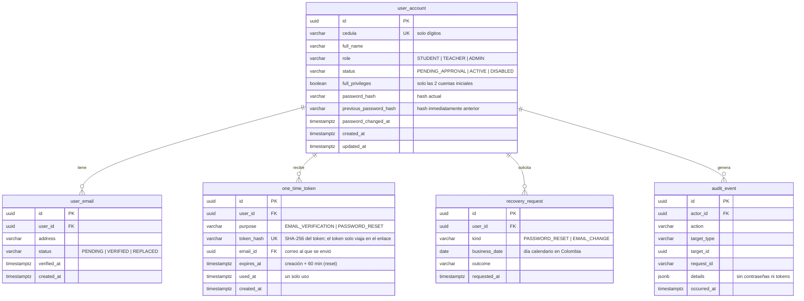

# Modelo de datos

## Convenciones (aplican desde ya)

| Tema | Convención |
| --- | --- |
| Migraciones | Flyway en `backend/src/main/resources/db/migration`, nombre `V<n>__<descripcion_en_español>.sql`. Una migración aplicada **nunca** se edita; los cambios van en una nueva |
| Nombres | Tablas y columnas en inglés, `snake_case`, tablas en singular (`user_account`, `activity`) |
| Claves | `id UUID` como clave primaria |
| Fechas | `TIMESTAMPTZ` (se guardan en UTC). Una fecha de negocio "en Colombia" se guarda como `DATE` calculada con `America/Bogota` cuando una regla la necesita |
| Notas | `NUMERIC(2,1)` con `CHECK (valor BETWEEN 0.0 AND 5.0)` |
| Porcentajes | `NUMERIC(5,2)` entre 0 y 100 |
| Enumeraciones | `VARCHAR` con `CHECK` (más simple de migrar que tipos `ENUM` de PostgreSQL) |
| Auditoría | Columnas `created_at` y `updated_at` en tablas de negocio |
| Archivos | Nunca binarios en la base de datos: solo metadatos y la clave del objeto en el almacenamiento |
| Secretos | Contraseñas y tokens solo como hash; nunca en texto plano ni en logs |

## Esquema actual (implementado)

| Migración | Contenido |
| --- | --- |
| `V1__linea_base.sql` | Línea base: no crea tablas de negocio. Flyway crea su tabla `flyway_schema_history` |

## Propuesta para la Etapa 3 · Identidad y acceso

> **Propuesta para revisión, no implementada.** Depende de las decisiones P-01 a P-04 de [decisiones.md](decisiones.md).

Cómo cubre las reglas aprobadas:

- **RNF-02 / RN-25 (dos hashes)**: al cambiar la contraseña, `previous_password_hash ← password_hash`, `password_hash ← nuevo`; el hash más antiguo desaparece porque se sobrescribe. Nunca hay texto plano.
- **RN-23 (token)**: el token aleatorio se envía en el enlace; en la base solo queda su hash, su vencimiento (60 min) y `used_at`. Un token usado o vencido se rechaza.
- **RN-23 (2 por día)**: se cuentan filas de `recovery_request` por `user_id`, `kind` y `business_date` (fecha en `America/Bogota`).
- **RN-24 / RN-25 (correo)**: el correo de recuperación es el último `user_email` con estado `VERIFIED`. Un correo nuevo entra como `PENDING` y solo al verificarse pasa a `VERIFIED` y el anterior a `REPLACED`. "Último correo registrado" = el `VERIFIED` vigente.
- **RN-16**: la regla "al menos una cuenta inicial activa con privilegio completo" se aplica en el caso de uso y se respalda con una prueba.
- **Cierre de sesiones**: depende de P-01 (con Spring Session JDBC se agregan sus tablas `spring_session` y `spring_session_attributes`).

La habilitación de cédulas por el docente (RN-01) y las matrículas pertenecen al módulo `courses` y se diseñarán junto con la Etapa 3.
