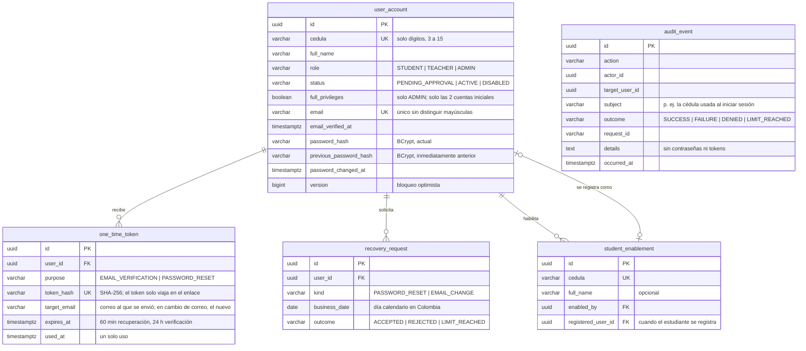

# Modelo de datos

## Convenciones (aplican desde ya)

| Tema | Convención |
| --- | --- |
| Migraciones | Flyway en `backend/src/main/resources/db/migration`, nombre `V<n>__<descripcion_en_español>.sql`. Una migración aplicada **nunca** se edita; los cambios van en una nueva |
| Nombres | Tablas y columnas en inglés, `snake_case`, tablas en singular (`user_account`, `activity`) |
| Claves | `id UUID` como clave primaria |
| Fechas | `TIMESTAMPTZ` (se guardan en UTC). Una fecha de negocio "en Colombia" se guarda como `DATE` calculada con `America/Bogota` cuando una regla la necesita |
| Notas | `NUMERIC(2,1)` con `CHECK (valor BETWEEN 0.0 AND 5.0)` |
| Porcentajes | `NUMERIC(5,2)` entre 0 y 100 |
| Enumeraciones | `VARCHAR` con `CHECK` (más simple de migrar que tipos `ENUM` de PostgreSQL) |
| Auditoría | Columnas `created_at` y `updated_at` en tablas de negocio |
| Archivos | Nunca binarios en la base de datos: solo metadatos y la clave del objeto en el almacenamiento |
| Secretos | Contraseñas y tokens solo como hash; nunca en texto plano ni en logs |

## Esquema actual (implementado)

| Migración | Contenido |
| --- | --- |
| `V1__linea_base.sql` | Línea base: no crea tablas de negocio. Flyway crea su tabla `flyway_schema_history` |
| `V2__identidad_y_acceso.sql` | Etapa 3: cuentas, tokens de un solo uso, límites de recuperación, cédulas habilitadas, auditoría y sesiones (`spring_session`, `spring_session_attributes`) |

## Identidad y acceso (Etapa 3, implementado)

Cómo cubre las reglas aprobadas:

- **RNF-02 / RN-25 (dos hashes)**: al cambiar la contraseña, `previous_password_hash ← password_hash` y `password_hash ← nuevo`; el más antiguo se sobrescribe. Nunca hay texto plano.
- **RN-23 (token)**: en la base solo queda el hash del token, su vencimiento y `used_at`. Un token usado o vencido se rechaza; emitir uno nuevo invalida los anteriores sin usar del mismo propósito.
- **RN-23 / D-04 (2 por día)**: se cuentan las filas de `recovery_request` por cuenta, `kind` y `business_date` (fecha en `America/Bogota`). `LIMIT_REACHED` no suma; en cambio de correo, un intento con datos incorrectos (`REJECTED`) sí suma.
- **RN-24 / RN-25 (correo)**: hay un solo correo vigente, en `user_account.email`. Un correo nuevo espera en `one_time_token.target_email` y solo reemplaza al actual cuando se abre el enlace (T-18).
- **RN-16**: los casos de uso rechazan cualquier cambio que deje la plataforma sin una cuenta inicial activa con privilegio completo; el arranque además lo restablece (T-17).
- **D-01**: al cambiar o restablecer la contraseña se borran las filas de `spring_session` de la cuenta (el nombre del principal es el `id` de la cuenta).
- **RN-01**: el registro de estudiante exige una fila en `student_enablement` con su cédula y sin `registered_user_id`.
