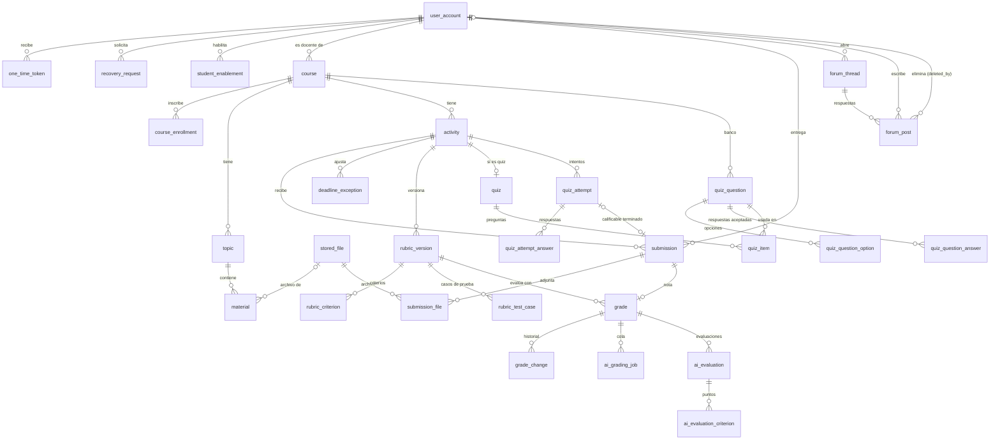
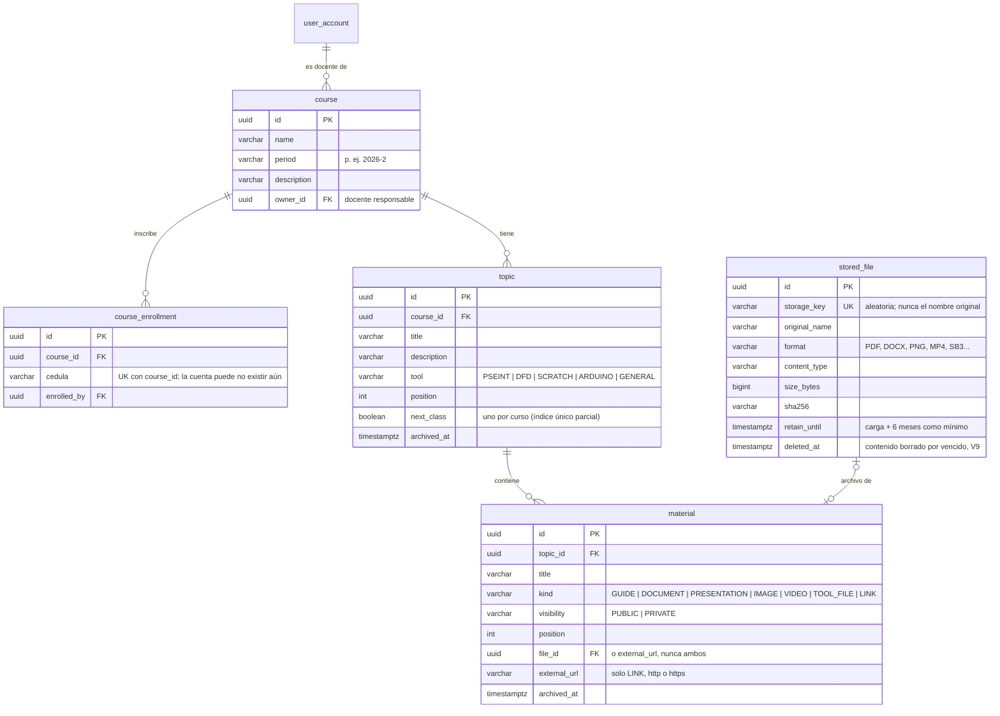
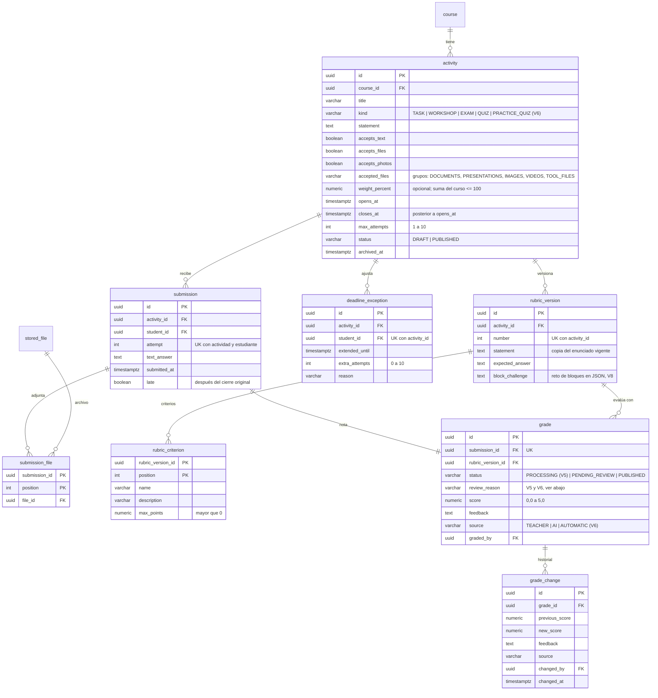
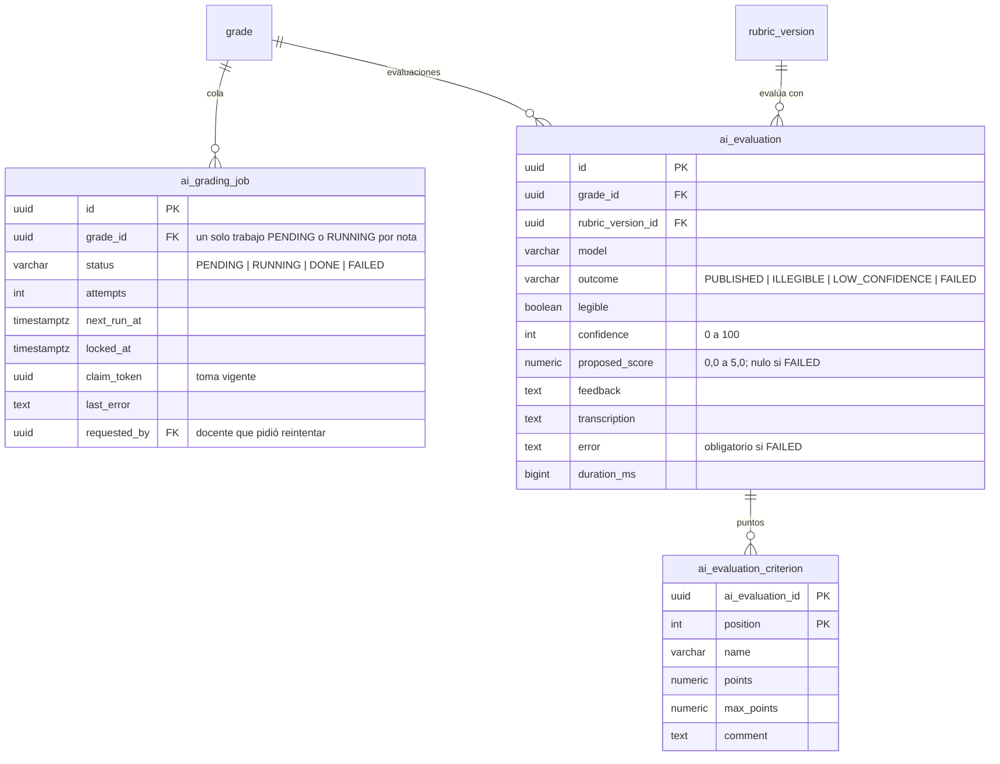
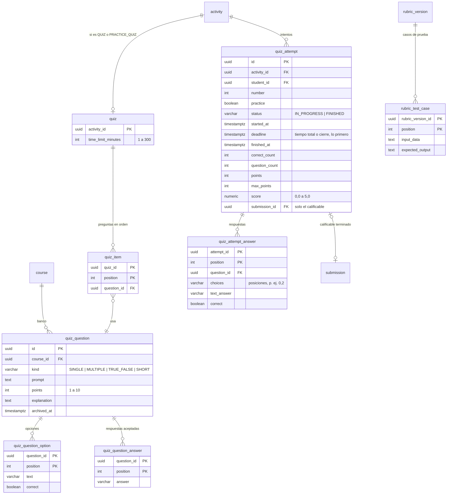
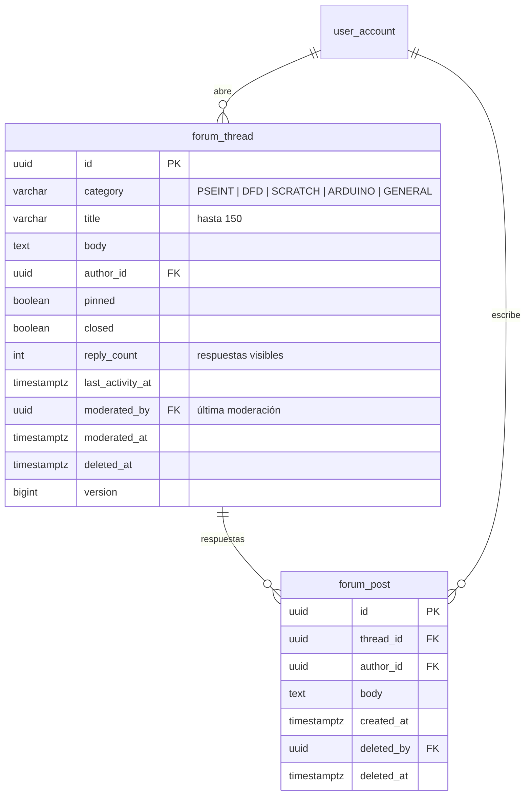

# Modelo de datos

## Convenciones (aplican desde ya)

| Tema | Convención |
| --- | --- |
| Migraciones | Flyway en `backend/src/main/resources/db/migration`, nombre `V<n>__<descripcion_en_español>.sql`. Una migración aplicada **nunca** se edita; los cambios van en una nueva |
| Nombres | Tablas y columnas en inglés, `snake_case`, tablas en singular (`user_account`, `activity`) |
| Claves | `id UUID` como clave primaria |
| Fechas | `TIMESTAMPTZ` (se guardan en UTC). Una fecha de negocio "en Colombia" se guarda como `DATE` calculada con `America/Bogota` cuando una regla la necesita |
| Notas | `NUMERIC(2,1)` con `CHECK (valor BETWEEN 0.0 AND 5.0)` |
| Porcentajes | `NUMERIC(5,2)` entre 0 y 100 |
| Enumeraciones | `VARCHAR` con `CHECK` (más simple de migrar que tipos `ENUM` de PostgreSQL) |
| Auditoría | Columnas `created_at` y `updated_at` en tablas de negocio |
| Archivos | Nunca binarios en la base de datos: solo metadatos y la clave del objeto en el almacenamiento |
| Secretos | Contraseñas y tokens solo como hash; nunca en texto plano ni en logs |

## Esquema actual (implementado)

Revisado contra las migraciones `V1` a `V9` el 2 de noviembre de 2026. Son 31 tablas de negocio, más `flyway_schema_history` (de Flyway) y las dos de sesiones de Spring Session. Las fechas `created_at`, `updated_at` y la columna `version` (bloqueo optimista) se omiten en los diagramas cuando no aportan.

| Migración | Contenido |
| --- | --- |
| `V1__linea_base.sql` | Línea base: no crea tablas de negocio. Flyway crea su tabla `flyway_schema_history` |
| `V2__identidad_y_acceso.sql` | Etapa 3: cuentas, tokens de un solo uso, límites de recuperación, cédulas habilitadas, auditoría y sesiones (`spring_session`, `spring_session_attributes`) |
| `V3__cursos_temas_y_biblioteca.sql` | Etapa 4: cursos, inscripciones, archivos cargados, temas y materiales |
| `V4__actividades_y_entregas.sql` | Etapa 5: actividades, entregas y sus archivos, excepciones de plazo, versiones de rúbrica con criterios, notas e historial de notas |
| `V5__calificacion_con_ia.sql` | Etapa 6: estado `PROCESSING` y motivo de revisión en las notas, cola de evaluación con IA, evaluaciones de la IA con sus puntos por criterio |
| `V6__quizzes_y_pseint.sql` | Etapa 7: tipos de actividad `QUIZ` y `PRACTICE_QUIZ`, casos de prueba en la rúbrica, notas `AUTOMATIC` y motivo `CODE_ERROR`, banco de preguntas, quizzes, intentos y sus respuestas |
| `V7__foro.sql` | Etapa 8: hilos y respuestas del foro. La planilla y las estadísticas se calculan con las tablas existentes y los respaldos viven en el volumen `backups`, no en la base |
| `V8__retos_de_bloques.sql` | Retos de bloques (RF-12): columna `block_challenge` en `rubric_version` con el reto en JSON (tablero, orientación, máximo de bloques, bloques permitidos y programa inicial), T-72 |
| `V9__borrado_de_archivos_vencidos.sql` | Borrado de archivos vencidos (RNF-12): columna `deleted_at` en `stored_file` e índice de los que vencen, T-88 |

## Vista de conjunto

Relaciones principales entre todas las tablas (sin columnas). El detalle de cada grupo está en las secciones siguientes.

Tablas sin relación de clave foránea: `audit_event` (guarda `actor_id` y `target_user_id` sin FK, para que la auditoría sobreviva a cualquier cambio de cuentas), `course_enrollment.cedula` (la inscripción es por cédula, no por cuenta, T-24) y `spring_session` / `spring_session_attributes` (el principal es el `id` de la cuenta como texto).

El modelo de datos del análisis de la Etapa 6 ([diagramas/3-modelo-datos.mmd](diagramas/3-modelo-datos.mmd), [imagen](diagramas/3-modelo-datos.png)) muestra solo las tablas del flujo de entrega y calificación. Se corrigió en esta revisión: `GRADE.source` decía `TEACHER, AI` y la migración `V6` agregó `AUTOMATIC` (casos de prueba, retos de bloques y quizzes).

## Identidad y acceso (Etapa 3, implementado)

Cómo cubre las reglas aprobadas:

- **RNF-02 / RN-25 (dos hashes)**: al cambiar la contraseña, `previous_password_hash ← password_hash` y `password_hash ← nuevo`; el más antiguo se sobrescribe. Nunca hay texto plano.
- **RN-23 (token)**: en la base solo queda el hash del token, su vencimiento y `used_at`. Un token usado o vencido se rechaza; emitir uno nuevo invalida los anteriores sin usar del mismo propósito.
- **RN-23 / D-04 (2 por día)**: se cuentan las filas de `recovery_request` por cuenta, `kind` y `business_date` (fecha en `America/Bogota`). `LIMIT_REACHED` no suma; en cambio de correo, un intento con datos incorrectos (`REJECTED`) sí suma.
- **RN-24 / RN-25 (correo)**: hay un solo correo vigente, en `user_account.email`. Un correo nuevo espera en `one_time_token.target_email` y solo reemplaza al actual cuando se abre el enlace (T-18).
- **RN-16**: los casos de uso rechazan cualquier cambio que deje la plataforma sin una cuenta inicial activa con privilegio completo; el arranque además lo restablece (T-17).
- **D-01**: al cambiar o restablecer la contraseña se borran las filas de `spring_session` de la cuenta (el nombre del principal es el `id` de la cuenta).
- **RN-01**: el registro de estudiante exige una fila en `student_enablement` con su cédula y sin `registered_user_id`.
- `spring_session` (`primary_id`, `session_id`, `principal_name`, tiempos de creación, último acceso y vencimiento) y `spring_session_attributes` siguen el esquema oficial de Spring Session JDBC para PostgreSQL.
- `user_account` exige que `full_privileges` solo sea verdadero con `role = ADMIN` (`user_account_full_privileges_ck`) y que la cédula tenga de 3 a 15 dígitos.

## Cursos, temas y biblioteca (Etapa 4, implementado)

- **RN-03 / RN-17**: un material privado solo lo ven los inscritos (por cédula), el docente responsable y las cuentas Administrador. Para los demás responde `404`.
- **RNF-04 / RN-21**: `files` comprueba la extensión permitida para el tipo de material, el tamaño (500 MB; 1 GB videos) y la firma del contenido antes de guardar.
- **RNF-12**: temas y materiales se archivan (`archived_at`); el archivo se conserva al menos hasta `retain_until`. Después, si su material o tema está archivado o nada lo usa, el proceso diario borra el contenido y anota `deleted_at` (V9, T-88). Los archivos de entregas no se borran.

## Actividades, entregas y notas (Etapas 5 a 7 y RF-12, implementado)

- `activity` exige al menos una forma de entrega salvo en los quizzes (`activity_modes_ck`), cierre posterior a la apertura, de 1 a 10 intentos y porcentaje entre 0 y 100; el quiz de repaso no tiene porcentaje (`activity_practice_weight_ck`, V6).
- **RF-12 (V8)**: `rubric_version.block_challenge` guarda el reto de bloques en JSON (tablero, orientación inicial, máximo de bloques, bloques permitidos y programa inicial). Una actividad usa casos de prueba o reto de bloques, no los dos (lo valida la aplicación, T-73).
- **RN-20**: cada entrega guarda en `grade.rubric_version_id` la versión vigente al enviarla; editar la rúbrica o el enunciado crea una fila nueva en `rubric_version`.
- **RN-05**: la actividad vencida sin entrega no tiene fila: el estado `OVERDUE` (0,0) se calcula al consultar (T-32).
- Las entregas y las notas no se borran; archivar la actividad solo la oculta.
- `grade.review_reason` dice por qué una nota espera al docente: `AI_DISABLED`, `UNSUPPORTED`, `ILLEGIBLE`, `LOW_CONFIDENCE`, `AI_FAILED` (V5) y `CODE_ERROR` (V6). Una nota `PUBLISHED` siempre tiene `score` (`grade_published_ck`). Los estados y sus transiciones están en [casos-de-uso.md](casos-de-uso.md#estados-de-una-entrega).

## Calificación con IA (Etapa 6, implementado)

Migración `V5__calificacion_con_ia.sql`. `grade.status` admite además `PROCESSING` y `grade.review_reason` dice por qué una nota espera al docente: `AI_DISABLED`, `UNSUPPORTED`, `ILLEGIBLE`, `LOW_CONFIDENCE` o `AI_FAILED`.

- **RF-17**: cada evaluación de la IA queda guardada, incluidas las fallidas, aunque el docente califique antes o después (T-43).
- **RN-11**: un fallo técnico no deja nota: `ai_evaluation_failed_ck` exige `proposed_score` nulo y un `error`.
- La nota publicada sigue viviendo en `grade` con `source = AI` o `TEACHER`; confirmar la propuesta registra la nota del docente y su historial.

## Quizzes y casos de prueba (Etapa 7, implementado)

- **RN-13**: `quiz_attempt_open_uk` deja un solo intento en curso por estudiante y quiz; `quiz_attempt_deadline_ix` permite encontrar rápido los vencidos para enviarlos (T-56).
- **RN-14**: `score` se calcula al terminar a partir de `points` y `max_points`; un intento terminado siempre tiene nota (`quiz_attempt_finished_ck`).
- **RN-20**: los casos de prueba y la clave del quiz quedan en la versión de rúbrica; una entrega se califica con la versión vigente cuando llegó (T-54).
- El calificable terminado crea una fila en `submission` (con el resumen como texto) y su `grade` con `source = AUTOMATIC`; así entra al historial y a la planilla igual que las demás actividades (T-53). El de repaso no crea entrega ni nota.
- `quiz_item` y `quiz_attempt_answer` no borran preguntas en cascada: una pregunta usada solo se archiva (T-55).

## Foro (Etapa 8, implementado)

- **RF-26**: `forum_thread_list_ix` sirve la lista de hilos visibles (fijados primero, luego por actividad reciente).
- **RN-15**: eliminar marca `deleted_at` (y `deleted_by` o `moderated_by`); nada se borra de la base (T-65). `reply_count` cuenta solo respuestas visibles y no baja de cero (`forum_thread_replies_ck`).
- `version` evita que dos moderadores se pisen al fijar o cerrar al mismo tiempo.
