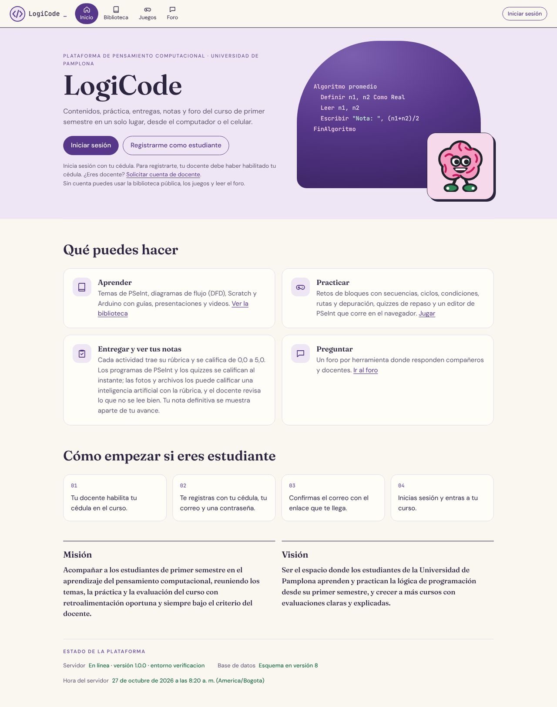
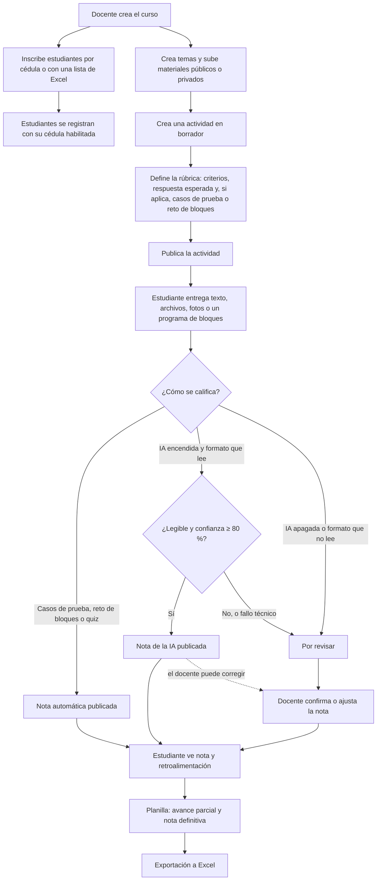

# Visión general de LogiCode

LogiCode es una plataforma web para enseñar y practicar la lógica de programación en el curso de Pensamiento Computacional de primer semestre de la Universidad de Pamplona. Reúne en un solo lugar los temas y materiales del curso, las actividades con su rúbrica, las entregas, la calificación (manual, automática y con inteligencia artificial), la planilla de notas, los quizzes, un intérprete de PSeInt, juegos de práctica y un foro.

Versión 1.0.0. Fecha objetivo de entrega: 10 de diciembre de 2026. Estado detallado en [estado.md](estado.md).

## El problema

Los materiales, tareas y notas de Pensamiento Computacional suelen quedar repartidos entre correos, chats y archivos. Quienes inician la universidad necesitan repasar algoritmos y practicar con orientación. El docente necesita publicar contenidos, recibir entregas y agilizar una parte de la calificación sin perder el control pedagógico.

## La propuesta

| Necesidad | Qué ofrece LogiCode |
| --- | --- |
| Contenidos dispersos | Curso con temas por herramienta (PSeInt, DFD, Scratch, Arduino o General), materiales públicos o privados y una biblioteca pública con búsqueda y filtros |
| Entregas por varios canales | Actividades con fechas, intentos y rúbrica; entrega por texto, archivo o foto desde el computador o el celular |
| Calificar toma tiempo | Calificación automática para programas de PSeInt con casos de prueba, retos de bloques y quizzes; calificación con IA local para fotos y archivos, que publica sola solo cuando leyó bien y su confianza es de 80 % o más |
| Notas poco claras | Escala 0,0 a 5,0, historial de cada cambio, planilla con avance parcial y nota definitiva por separado, exportación a Excel |
| Práctica sin presión | Juegos sin nota, quizzes de repaso y un editor de PSeInt |
| Dudas fuera de clase | Foro por herramienta, de lectura pública y moderado |

**Misión** (texto de la página de inicio, propuesta a partir de la especificación): acompañar a los estudiantes de primer semestre en el aprendizaje del pensamiento computacional, reuniendo los temas, la práctica y la evaluación del curso con retroalimentación oportuna y siempre bajo el criterio del docente.

**Visión**: ser el espacio donde los estudiantes de la Universidad de Pamplona aprenden y practican la lógica de programación desde su primer semestre, y crecer a más cursos con evaluaciones claras y explicadas.

## Quién la usa

| Rol | Qué puede hacer |
| --- | --- |
| Visitante (sin cuenta) | Ver el inicio, la biblioteca pública y los materiales públicos, jugar los juegos y leer el foro |
| Estudiante | Lo anterior, más: ver el contenido privado de su curso, entregar actividades, presentar quizzes, retos de bloques, usar el editor de PSeInt, escribir en el foro y consultar sus notas y la retroalimentación |
| Docente | Administrar su curso: inscribir estudiantes (una cédula o una lista de Excel o CSV), temas, materiales, actividades con rúbrica, casos de prueba y retos de bloques, banco de preguntas y quizzes; calificar y corregir notas; dar plazos e intentos adicionales; ver y exportar la planilla; moderar el foro. Su cuenta queda pendiente hasta que un Administrador la aprueba |
| Administrador (cuenta ordinaria) | Panel con cifras, aprobar docentes, activar y desactivar cuentas, habilitar cédulas, auditoría, publicar u ocultar y archivar materiales de la biblioteca, moderar el foro, respaldos, y consultar en solo lectura actividades, entregas y notas. **No** cambia roles, no responde actividades, no crea temas, materiales ni actividades, no califica ni ajusta notas |
| Administrador inicial (privilegio completo) | Todo lo anterior y todo lo del docente y del estudiante, más cambiar el rol de cualquier cuenta. Son solo dos cuentas, las de Carlos Alberto Escamilla Mariño y Yarly Melitza Guerrero Berbesi, y la plataforma nunca puede quedarse sin una de ellas activa |

Matriz completa en [permisos.md](permisos.md).

## Funciones por área

| Área | Funciones | Estado |
| --- | --- | --- |
| Acceso y cuentas | Registro de estudiante con cédula habilitada, solicitud y aprobación de docentes, ingreso con cédula, verificación de correo, recuperación de contraseña, cambio asistido de correo, roles, auditoría | Implementado. Correos reales con Brevo desde `logicode.notificaciones@gmail.com` (P-06) |
| Curso y contenidos | Cursos, inscripción por cédula o lista `.xlsx`/`.csv`, temas ordenados, próxima clase, materiales con vista previa y descarga, biblioteca pública con filtros | Implementado |
| Actividades y entregas | Tareas, talleres, evaluaciones, quizzes; apertura, cierre, porcentaje, intentos; rúbrica versionada; entrega por texto, archivos o fotos; excepciones de plazo; bandeja Por revisar | Implementado |
| Calificación | Manual con historial; automática por casos de prueba de PSeInt, por reto de bloques (RF-12) y por quiz; con IA (Ollama + Qwen2.5-VL 7B) para fotos, texto, `.psc`, `.ino` y PDF | Implementado. Pruebas de aceptación de Qwen en el equipo de referencia: **Pendiente** |
| Quizzes | Banco de preguntas de cuatro tipos, quiz calificable y de repaso, tiempo total con envío automático, ranking | Implementado |
| Práctica | Editor e intérprete de PSeInt con límites; seis juegos con 99 niveles en un catálogo con filtros por herramienta y tema | Implementado. Niveles de `/juegos` editables por el docente: **Pendiente** (no pedido) |
| Notas | Planilla con porcentajes, avance parcial y nota definitiva; estadísticas; exportación `.xlsx` y CSV; "Mis notas" para el estudiante | Implementado |
| Comunidad | Foro por herramienta con moderación | Implementado |
| Operación | Panel de administración, respaldos diarios con prueba de restauración, modo piloto con HTTPS | Implementado. Piloto con el docente y acta firmada: **Pendiente** |

## Cómo fluye un curso de principio a fin

1. **Preparar el curso.** El docente crea el curso y queda como responsable. Inscribe a los estudiantes por cédula (una a una o con una lista `.xlsx` o `.csv`); inscribir también habilita la cédula para el registro.
2. **Contenidos.** Crea temas, los ordena, marca la próxima clase y sube guías, presentaciones, videos, archivos de PSeInt, Arduino o Scratch, o enlaces. Lo público aparece también en la biblioteca.
3. **Actividad con rúbrica.** Crea la actividad como borrador, define la rúbrica (criterios con puntos y respuesta esperada) y, si quiere calificación automática, casos de prueba de PSeInt o un reto de bloques. Sin rúbrica no se publica. Cada cambio crea una versión nueva de la rúbrica.
4. **Entrega.** El estudiante entrega antes del cierre. El sistema valida el formato real y el tamaño, y guarda el intento.
5. **Calificación.** Según la actividad, la nota sale sola (casos de prueba, reto de bloques, quiz), la propone la IA (que solo publica si la entrega es legible y su confianza es de 80 % o más) o espera al docente en **Por revisar**. Un fallo técnico nunca pone nota.
6. **Revisión.** El docente confirma o ajusta las notas pendientes y puede corregir cualquier nota publicada; cada cambio queda en el historial.
7. **Planilla.** La planilla reúne todo con los porcentajes, separa el avance parcial de la nota definitiva y se exporta a Excel. Una actividad vencida sin entrega vale 0,0, salvo que el docente la reabra para ese estudiante.

El detalle de cada paso está en los [casos de uso](casos-de-uso.md). El flujo de datos de entregar y calificar está modelado en el [DFD de contexto](diagramas/1-dfd-contexto.png) y el [DFD de nivel 1](diagramas/2-dfd-nivel1.png) (fuentes en [diagramas/](diagramas/)).

## Tecnología

| Pieza | Tecnología |
| --- | --- |
| Interfaz | React 19 con Vite, en JavaScript; CSS propio responsive con el estilo del rediseño de Canva (fuentes Fraunces, DM Sans y JetBrains Mono incluidas en el proyecto) |
| Borde | Nginx: sirve la interfaz, reenvía `/api` al backend, CSP y cabeceras de seguridad, HTTPS en el piloto |
| API | REST con JSON bajo `/api/v1`, errores RFC 9457, OpenAPI con springdoc |
| Backend | Java 21 y Spring Boot 4.1 (4.1.2), monolito modular con capas `api`, `application`, `domain` e `infrastructure` verificadas con ArchUnit; Spring Security, Spring Session JDBC, BCrypt |
| Base de datos | PostgreSQL 17 con migraciones Flyway (`V1` a `V8`) |
| Archivos | MinIO (almacenamiento de objetos compatible con S3) en Docker |
| IA (opcional) | Ollama 0.35.1 con Qwen2.5-VL 7B (Q4_K_M), local, perfil `ia` de Docker Compose |
| Excel y PDF | Apache POI 5.5.1 (importar lista y exportar planilla `.xlsx`), Apache PDFBox 3.0.8 (la IA lee PDF) |
| Correo | Brevo para el envío real; bandeja local `.local/mail-outbox` en desarrollo |
| Despliegue | Docker Compose: `db`, `minio`, `backend`, `frontend`, `backup` y `ollama` (opcional) |
| Pruebas | JUnit 5, Testcontainers, ArchUnit; Vitest y Testing Library; oxlint; axe-core para accesibilidad |

Arquitectura completa en [arquitectura.md](arquitectura.md).

## Estado actual en resumen

### Implementado

- Etapas 2 a 10 de la especificación: fundaciones, acceso y permisos, curso y biblioteca, actividades y entregas, calificación con IA en segundo plano, quizzes, PSeInt y juegos, foro, planilla, panel y respaldos, calidad y seguridad, modo piloto con HTTPS, página de inicio y manuales.
- Ampliaciones después de la Etapa 10: retos de bloques que configura el docente (RF-12, base de datos versión 8); Excel (importar lista y exportar planilla, P-07) y PDF leído por la IA (P-08); juegos con más niveles y personajes del robot; juego "Caza el error"; rediseño visual con el Canva; juegos como catálogo con filtros; juego de Arduino, niveles de matrices y textos en PSeInt y ciclos en "Completa el DFD".
- Documentación de la Etapa 1: casos de uso, historias de usuario y maquetas (este conjunto de documentos).

### Pendiente

| Pendiente | Detalle |
| --- | --- |
| Pruebas de aceptación de Qwen2.5-VL en el equipo de referencia | Arnés en [ia-pruebas/](../ia-pruebas/README.md). Ensayo del 1 de noviembre con 3 imágenes sintéticas: lee bien, pero la confianza reportada no separó aciertos de errores. Falta medir con fotos manuscritas reales; la regla del 80 % se mantiene |
| Piloto con el docente y acta firmada | Plan y acta en [piloto.md](piloto.md) |
| Revisión de Carlos de las ampliaciones | Retos de bloques, Excel y PDF, rediseño, catálogo y niveles nuevos de los juegos ([estado.md](estado.md)) |
| Alojamiento en línea (P-09) | En observación; todo despliegue futuro será con Docker |
| Niveles de `/juegos` editables por el docente | Los niveles están fijos en el código; el docente configura retos con nota solo con RF-12 |
| La IA lee Word, PowerPoint, video y Scratch | No aprobado; esas entregas van al docente |
| Limpieza automática de archivos después de la retención | Hoy nada se borra |
| Rúbricas de referencia y prueba de lectura manuscrita de la Etapa 1 | Ver [estado.md](estado.md) |

### Decisión aprobada

- Ollama + Qwen2.5-VL 7B local como proveedor de IA, con publicación automática solo con contenido legible y confianza reportada de 80 % o más.
- Solo las dos cuentas iniciales tienen privilegio completo y cambian roles.
- Escala 0,0 a 5,0; vencida sin entrega = 0,0 salvo reapertura; nota definitiva separada del avance parcial.
- Archivos de hasta 500 MB (videos 1 GB), conservados al menos seis meses.
- Desarrollo, pruebas y primer despliegue en local con Docker; publicación en línea en observación.

Lista completa en [decisiones.md](decisiones.md).

## Glosario

| Término | Significado |
| --- | --- |
| Cuenta inicial | Una de las dos cuentas Administrador con privilegio completo, creadas desde `.env` al arrancar. Son las únicas que cambian roles |
| Administrador ordinario | Cuenta con rol Administrador sin privilegio completo: tareas administrativas y consulta, sin calificar ni crear contenido |
| Cédula habilitada | Cédula que un docente o administrador agregó para que su dueño pueda registrarse como estudiante |
| Rúbrica versionada | Cada cambio de la rúbrica o del enunciado crea una versión nueva; cada entrega queda ligada a la versión vigente cuando se envió |
| Respuesta esperada | Solución de referencia de la rúbrica. La ven el docente, los administradores y la IA; nunca el estudiante |
| Casos de prueba | Entradas y salidas esperadas de un taller de PSeInt; la nota es 5 × casos aprobados ÷ total |
| Reto de bloques | Actividad calificable en la que el estudiante programa un robot con bloques en un tablero que define el docente (RF-12); 5,0 si llega a la meta, 0,0 si no |
| Por revisar | Bandeja del docente con las entregas que esperan su nota, con el motivo (calificación manual, foto ilegible, confianza baja, formato que la IA no lee, programa que no se pudo ejecutar, falló la IA) |
| Calificando con IA | Estado de una entrega mientras la IA la evalúa en segundo plano |
| Confianza IA 80 % | Umbral fijo: la nota de la IA se publica sola solo si la entrega es legible y la confianza reportada por el modelo es de 80 % o más. Un 80 % reportado no significa 80 % de acierto; la calibración se mide en las pruebas de aceptación |
| Fallo técnico | El modelo no respondió, tardó demasiado o respondió algo que no cuadra con la rúbrica. Se reintenta hasta 3 veces y nunca se publica una nota inventada |
| Nota automática | Nota calculada sin docente ni IA: casos de prueba, reto de bloques o quiz |
| Avance parcial | Promedio con porcentajes de las actividades que ya tienen resultado |
| Nota definitiva | Existe solo cuando los porcentajes suman 100 % y todas las actividades tienen resultado; se muestra aparte del avance |
| Vencida sin entrega | Actividad cerrada sin entrega: vale 0,0 (se marca con `*`) |
| Excepción de plazo | Plazo nuevo o intentos adicionales para un estudiante en una actividad; la entrega fuera del plazo original queda marcada "tarde" |
| Reapertura | Usar una excepción de plazo después del cierre para que un estudiante pueda entregar; el 0,0 desaparece |
| Modo piloto | Instalación con HTTPS (`docker-compose.piloto.yml`) para usar LogiCode desde los equipos y celulares del aula, con datos aparte de los de desarrollo |
| Datos demo | Cuentas y contenidos ficticios que carga `datos-demo/cargar-datos-demo.mjs`; contraseña pública, nunca en el piloto |
| Bundle | Archivo `.bundle` de Git con el código y su historial; se clona con `git clone -b main <archivo>.bundle` |
| Perfil `ia` | Perfil de Docker Compose que arranca el servicio Ollama |
| Outbox | Bandeja local de correos (`.local/mail-outbox`) que se usa cuando Brevo no está configurado |
